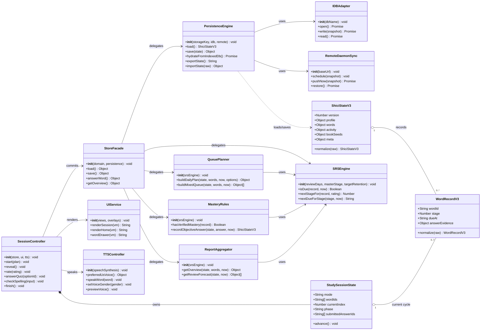
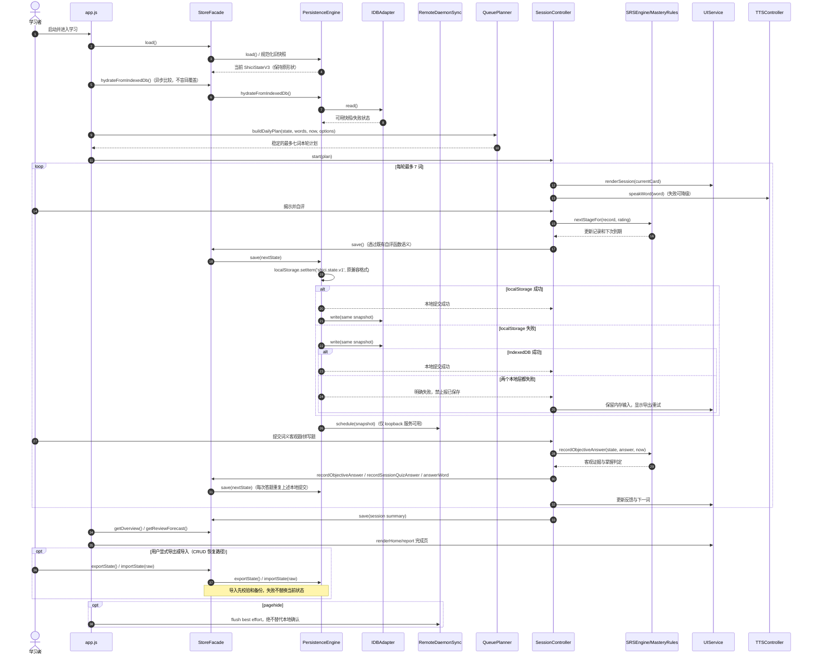
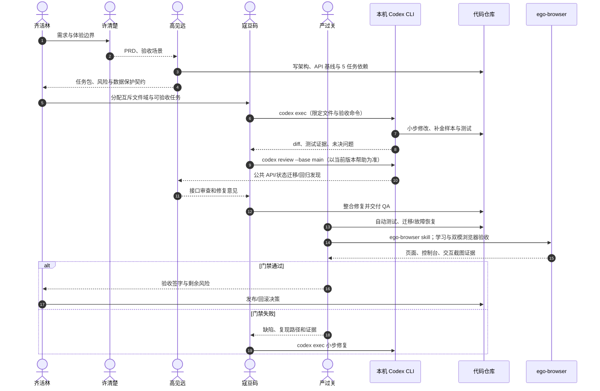
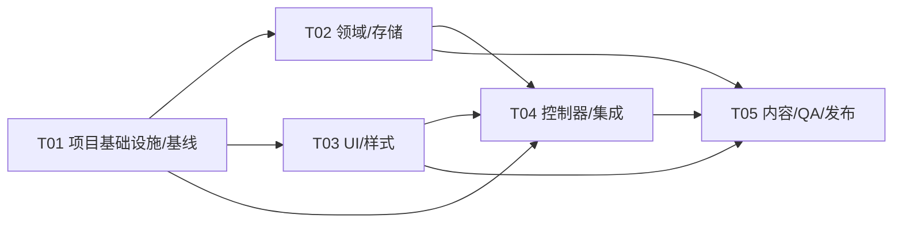

# 拾词（Shici）架构设计与 WorkBuddy × Codex 协同任务方案

> 设计基线：依据已核实的仓库结构与 Codex 审计结论。本文件是**目标方案，不是现状实现声明**。采用 5 个正式工程任务（架构任务上限），另设 12 个可独立签收的检查点；检查点不是另起的工程任务。迁移必须用原仓库行为夹具确认所有参数和状态字段，不能把以下示意接口当作已经存在的源码签名。
>
> 版本提示：本文件为重新组织的 5 任务方案；较早交付的 Codex 详细 T01–T12 工作草案已恢复保存于同级 `04-codex-detailed-task-plan.md`，供追溯，不应将两套同号任务并列执行。当前真实进度仅完成静态基线初版，词法缺陷仍在修复与复测中。

## 第一章 架构设计总览与技术选型

### 1.1 现状、难点与选择

| 基线 | 已核实事实 | 架构难点 |
|---|---|---|
| 静态入口 | `index.html` 301 行，含 SVG Sprite、`#bootScreen`、`#appShell`，预加载 `data/books/{activeBook}.js?v=26`；按 `product-analytics.js`、`data.js`、`store.js`、`ui.js`、`app.js` 顺序执行 | 全局脚本顺序及预载词书不可被重构破坏 |
| 状态/算法 | `js/store.js` 1657 行，公开 `window.Store`；`STORAGE_KEY='shici.state.v1'`、`SCHEMA_VERSION=3`、`DB_NAME='shici-progress'`、`REVIEW_DAYS=[1,2,4,7,15,30,60,90]`、`MASTER_STAGE=5`、`TARGET_RETENTION=0.85` | 领域计算、三层持久化、历史状态同文件交织 |
| 渲染/控制 | `js/ui.js` 1378 行，公开 `window.UI`；`js/app.js` 2264 行，`handleAction` 约 430 行 | 拆分需保持所有旧 `data-action`、路由与调用形状 |
| 样式/部署 | `css/styles.css` 9649 行；`serve.py` 245 行，监听 `127.0.0.1:4173`，提供 `/api/state`、`/api/health`、`/api/history`、`/api/export` | GitHub Pages 静态部署与本机进度快照 API 双模共存 |

**技术决策**：保留原生 JavaScript、原生 CSS、Python 标准库及传统有序 `<script defer src="…">`，不引入 Vite、React、MUI、Tailwind、构建器或 npm 运行时依赖。目标模块用 IIFE 命名空间（如 `window.ShiciDomain`、`window.ShiciStorage`、`window.ShiciViews`、`window.ShiciApp`）及显式加载次序连接；`js/store.js`、`js/ui.js` 继续提供 `window.Store`、`window.UI` 的**全量可观察兼容门面**，不是只保留本文件列出的代表函数。`js/app.js` 保持最后加载、负责引导。架构模式是“纯函数领域层 + 存储适配层 + 无副作用渲染层 + 控制器/门面”，而非更换前端框架。

双模运行：GitHub Pages 上无 `/api/*` 时继续使用 localStorage/IndexedDB、显示“本机备份不可用”，**不试图向 Pages 写进度**；本机 `serve.py` 仅绑定 loopback，远端层指向同源 `/api/state`，快照目录保持 `~/Library/Application Support/Shici/progress/`。`file://` 如目前可用，应尽可能保持静态词书与页面可读性；浏览器在 `file://` 下的 IndexedDB、Service Worker 或 fetch 能力不可保证，要做能力检测及降级，不能改为 ES Modules 导致整个入口加载失败。Service Worker 只在受支持 origin 注册，不缓存 `/api/`。

**拆分原则**：先冻结原函数签名、返回值、DOM/路由和状态金样本，逐个替换内部实现；不“顺手”改变复习天数、掌握阈值、数据字段或视觉级联。服务层仅作内部接口，原有对外函数的同步/异步行为必须与基线一致。对 `Store.getStatus` 等同名函数的上下文语义，以 T01 基线清单为准，不猜测。

## 第二章 目标分层架构与文件清单（File Tree）

`[现]` 表示既有文件继续维护；`[新]` 表示目标新增。除标注的测试与文档外，下列都是源码部署物，使用相对 URL。

```text
.
├── package.json                         [新] 仅元数据/验收脚本，dependencies 为空；无构建步骤
├── index.html                           [现] 静态壳与传统脚本顺序
├── serve.py                             [现] loopback 静态服务与快照 API
├── sw.js                                [现] 若存在则更新缓存列表/版本，不缓存 /api/
├── data/
│   └── books/*.js                       [现] 按 activeBook 预载的静态词书
├── js/
│   ├── product-analytics.js             [现] 保持先于业务脚本加载
│   ├── data.js                          [现] 词书数据访问门面
│   ├── domain/
│   │   ├── srs-engine.js                [新] 到期/评级/下一阶段纯函数
│   │   ├── queue-planner.js             [新] 今日计划与三类队列
│   │   ├── mastery-rules.js             [新] 客观题、拼写、掌握证据
│   │   └── report-aggregator.js         [新] 单元、连续天数、周序列、热力图、预测
│   ├── storage/
│   │   ├── state-schema.js              [新] 现有顶层 version=3、meta.schema=3 的规范化/迁移校验
│   │   ├── idb-adapter.js               [新] shici-progress 读写
│   │   └── remote-daemon-sync.js        [新] 同源 /api/state 同步及退出刷新
│   ├── store.js                         [现] window.Store 全量兼容 + localStorage 协调
│   ├── ui/
│   │   ├── helpers.js                   [新] 转义、日期、共用格式化
│   │   ├── views/
│   │   │   ├── home-view.js             [新] renderHome
│   │   │   ├── study-view.js            [新] renderStudyCenter、renderSession/卡片/题目
│   │   │   ├── library-view.js          [新] renderLibrary
│   │   │   ├── books-view.js            [新] renderBooks
│   │   │   └── report-view.js           [新] renderReport
│   │   └── overlays.js                  [新] wordDrawer、settingsDrawer、modal、searchSuggestions
│   ├── ui.js                            [现] window.UI 全量兼容门面
│   ├── app/
│   │   ├── router.js                    [新] parseHash、navigate、hashchange、页面装配
│   │   ├── session-controller.js        [新] 7 词会话、自评、客观题、拼写
│   │   ├── tts-controller.js            [新] 美音选择、性别偏好、预听
│   │   └── action-dispatcher.js         [新] 按现有 data-action 分组注册的分发器
│   └── app.js                           [现] 启动、装配、全局事件绑定
├── css/
│   ├── styles.css                       [现] 过渡期兼容入口；拆完后只保留明确导入/空壳
│   ├── 00-tokens.css                    [新] 设计变量
│   ├── 10-base.css                      [新] reset、文本、焦点
│   ├── 20-shell.css                     [新] 布局与导航
│   ├── 30-components.css                [新] 按钮、表单、卡片
│   ├── 40-views.css                     [新] 首页、学习、词库、书库、报告
│   ├── 50-study-overlay.css             [新] 卡片、题目、抽屉、弹窗
│   └── 60-responsive.css                [新] 断点与减少动画
├── tools/
│   ├── build_books.py                   [现]
│   ├── build_wenyan.py                  [现]
│   ├── build_wenyan_catalog.py          [现]
│   ├── content_audit.py                 [现]
│   ├── export_content_review.py         [现]
│   ├── check_project.py                 [现，如审计所确认]
│   ├── test_learning_system.sh          [现] ego-browser 学习回归
│   ├── deploy_local.sh                  [现]
│   ├── install_local.sh                 [现]
│   ├── check_static.py                  [新] 脚本顺序、CSS 引用、公共 API 静态门禁
│   └── tests/
│       ├── store-contract.test.js       [新] 全量 Store/UI API 基线
│       ├── domain-regression.test.js    [新] SRS、队列、报表金样本
│       └── persistence-recovery.test.js [新] 故障、迁移、冲突夹具
└── docs/
    └── 03-shici-architecture-and-task-plan.md [本文件]
```

**依赖方向**：`data → domain → store/storage → app` 是业务调用方向；`ui` 只接收 ViewModel，`app` 调用 `Store/UI/TTS`，`domain` 不访问 DOM/网络/浏览器存储。传统脚本按 `analytics → data → domain → storage → store → ui/helpers/views/overlays → ui → app/router/session/tts/actions → app` 显式排序，不能用动态 `import()` 作为启动必需条件。CSS 通过 `styles.css` 顶部有序 `@import` 或多个有序 `<link>` 二选一，避免同时加载旧规则与新规则造成双重级联；拆分时用截图基线逐块迁移。

## 第三章 核心数据结构与接口设计

### 3.1 数据契约与不变量

`ShiciStateV3` 是当前 `SCHEMA_VERSION=3` 状态的**概念模型**，不要求把现有 JSON 改包成 `{data,revision,…}` 信封；实际字段、时间类型、返回值在 T01 从源码和用户脱敏样本冻结。`WordRecordV3` 用 `wordId` 与词书关联；`StudySessionState` 为运行时会话状态，仅保存必要恢复信息。`STORAGE_KEY='shici.state.v1'` 与内部 schemaVersion 是不同概念，绝不按版本改 key。所有新增元信息若需要，应放在兼容扩展字段或 sidecar，先验证旧 `load`/`importState` 可读取，禁止未经迁移把已有状态整体重塑。

领域层目标内部接口（**非已确认的旧签名**）：

```js
ShiciDomain.SRSEngine.isDue(record, now)
ShiciDomain.SRSEngine.nextStageFor(record, rating)
ShiciDomain.SRSEngine.nextDueForStage(stage, now)
ShiciDomain.QueuePlanner.buildDailyPlan(state, words, now, options)
ShiciDomain.MasteryRules.recordObjectiveAnswer(state, answer, now)
ShiciDomain.MasteryRules.hasVerifiedMastery(record)
ShiciDomain.ReportAggregator.getOverview(state, words, now)
ShiciStorage.StateSchema.normalize(raw, now)
ShiciStorage.IDBAdapter.open()
ShiciStorage.IDBAdapter.write(snapshot)
ShiciStorage.RemoteDaemonSync.schedule(snapshot)
ShiciApp.SessionController.start(plan)
ShiciApp.SessionController.rate(rating)
ShiciApp.TTSController.speakWord(word)
```

门面必须保留现有 `Store.createDefaultState`、`normalizeRecord`、`load`、`save`、`openIndexedDb`、`writeIndexedDb`、`hydrateFromIndexedDb`、`prepareRemote`、`scheduleRemoteSave`、`flushRemoteOnExit`、`pushRemoteNow`、`restoreRemoteState`、`exportState`、`importState`、`getPersistence`，以及题给的 SRS、队列、学习、统计全部现有方法；此处清单**不替代 T01 全量枚举**。`UI` 保留全部现有视图、抽屉和辅助成员。App 的内部方法如 `parseHash`、`startSession`、`englishVoices`、`setVoiceGender` 等以原行为封装，不无故宣称为公开 API。

### 3.2 Mermaid 类图



类图中的 `__init__` 是**接口建模记法**，JS 实现可用工厂/IIFE 初始化，不要求创造 Python 类或 ES `class`。`stage/dueAt` 等字段均为概念占位，具体存量字段及类型以基线为准；`String` 日期仅表示规范化目标，不强制改写旧存储。

## 第四章 核心交互流程时序图

### 4.1 七词微循环：初始化、读取、自评、客观题与三层提交



“7 词”指每轮上限，最后一轮可少于 7；自评与客观题具体顺序、是否显示拼写依原会话逻辑与 T01 金样本，不新增强制题型。`save` 实际参数与是否同步由 T01 冻结；时序图描述**目标数据依赖与成功条件**，不是当前精确签名。

### 4.2 WorkBuddy 专家团 × 本机 Codex CLI 协同流水线



## 第五章 WorkBuddy 团队 × Codex 深度协同分工矩阵

| 角色 | 决策/执行边界 | 主要文件所有权 | 交接物与验收 |
|---|---|---|---|
| 齐活林（主理人） | 定范围、互斥派工、整合及最终发布；不替 QA 认定通过 | 总体任务板、集成窗口 | 冻结输入/输出清单、协调冲突、发布签字 |
| 许清楚（产品经理） | 用户路径、文案、7 词体验、异常提示；不改 SRS 常数 | PRD、验收场景 | 可复现的正常/断网/恢复场景和可读性确认 |
| 高见远（架构师） | 公共 API、算法映射、状态迁移与技术审查；不绕 QA 发布 | 本架构文档及领域/存储契约 | 类图、时序图、任务依赖、迁移风险签字 |
| 寇豆码（工程师） | 唯一运行时代码主编辑与 Codex 操作人；不擅改公共契约 | `js/**`、`css/**`、`index.html`、`serve.py`、`sw.js`、工具 | 精确 diff、测试输出、浏览器可用构建（零构建源码） |
| 严过关（QA） | 独立测试、回归与数据不丢失否决权 | `tools/tests/**` 的验收夹具、报告 | 失败复现、测试证据、通过/阻断决定 |
| 本机 Codex CLI | 被约束的实现和独立审查执行器；无产品或发布签字权 | 仅本次任务包允许的文件 | 补丁、`codex review` 发现、残余风险；不可跨任务覆盖 |

文件锁：每次 `codex exec` 明示**允许修改列表、禁止修改列表、输入夹具、验收命令**；架构/QA 可提评审意见，但不与工程师同时编辑同一运行时文件。主理人接收评审、仲裁公共契约变更。高风险更改应当让另一人审查 `git diff`，Codex 自审不能替代 QA。

CLI 标准调用样式（均为后续执行示例，**本次未运行**；先用本机 `codex --help`、`codex review --help` 核对版本）：

```bash
codex exec "仅修改任务包所列文件；保持 window.Store/window.UI 与 shici.state.v1 的可观察兼容；补回归测试；运行任务指定验收命令并报告 diff/风险"
codex review --base main
ego-browser skill
```

现有可用验收入口优先用 `python3 tools/check_project.py`、`python3 tools/content_audit.py --json`、`python3 tools/export_content_review.py --check`、`bash tools/test_learning_system.sh`。`build_books.py --check`、`build_wenyan.py --check`、`content_audit.py --strict` 和不存在的 `check_static.mjs` **不是现有命令**，不可在实施前当作已通过的门禁。内容 ETL 写入词书，不触碰用户进度。

## 第六章 有序任务分解（正式任务 T01–T05；12 个交付检查点）

**第三方依赖清单**：浏览器运行时无第三方 package（`package.json` 中 `dependencies` 与 `devDependencies` 均为空）。可选本机辅助：已安装的 `codex` CLI、`ego-browser`；Python 标准库、Node 原生测试能力由本机环境提供，不在网站部署时安装。若实际仓库无 `package.json`，T01 仅新增元数据/验收脚本，绝不切换模块加载语义。

| 任务 | 名称、优先级、执行角色 | 前驱 | 输入 → 输出（每项至少 3 个相关文件） | 验收命令/完成门 |
|---|---|---|---|---|
| **T01** | **项目基础设施与兼容基线**，P0；寇豆码主执行，严过关冻结样本，高见远审查 | 无 | 输入 `index.html`、`js/store.js`、`js/ui.js`、`js/app.js`、`serve.py`、`sw.js`、`tools/test_learning_system.sh` → 输出 `package.json`、`index.html`、`js/app.js`（仍维持原入口顺序）、`serve.py`、`sw.js`、`tools/check_static.py`、`tools/tests/store-contract.test.js` | `python3 tools/check_project.py`；`python3 tools/check_static.py`（新增后）；`bash tools/test_learning_system.sh`。冻结全量 `Store/UI` 键、签名、返回类型、旧路由、`data-action`、状态字节级快照；不得先改变行为 |
| **T02** | **领域算法、状态与三层持久化**，P0；高见远契约、寇豆码实现、严过关故障演练 | T01 | 输入 `js/store.js`、`js/data.js`、`serve.py` → 输出 `js/domain/srs-engine.js`、`queue-planner.js`、`mastery-rules.js`、`report-aggregator.js`、`js/storage/state-schema.js`、`idb-adapter.js`、`remote-daemon-sync.js`、`js/store.js`、`tools/tests/domain-regression.test.js`、`tools/tests/persistence-recovery.test.js` | `node --test tools/tests/domain-regression.test.js tools/tests/persistence-recovery.test.js`（测试文件新增后）；`python3 tools/check_static.py`。算法金样本一致，`shici.state.v1` 读取/导出/导入不丢字段，L1/L2 故障与 daemon 不可用通过 |
| **T03** | **UI 页面、弹层与样式分层**，P1；寇豆码实现，许清楚体验验收，严过关视觉回归 | T01 | 输入 `js/ui.js`、`css/styles.css`、`index.html` → 输出 `js/ui/helpers.js`、`js/ui/views/{home,study,library,books,report}-view.js`、`js/ui/overlays.js`、`js/ui.js`、`css/{00-tokens,10-base,20-shell,30-components,40-views,50-study-overlay,60-responsive}.css`、`css/styles.css` | `python3 tools/check_static.py`；`bash tools/test_learning_system.sh`。五个页面、会话、抽屉/弹窗、移动端与焦点无回归，`window.UI` 全量兼容；可与 T02 在 T01 后并行 |
| **T04** | **路由、会话、TTS、动作分发集成**，P0；寇豆码实现，高见远审查，严过关回归 | T01、T02、T03 | 输入 `js/app.js`、`js/store.js`、`js/ui.js` → 输出 `js/app/router.js`、`session-controller.js`、`tts-controller.js`、`action-dispatcher.js`、`js/app.js`、`index.html`、`tools/test_learning_system.sh` | `python3 tools/check_static.py`；`bash tools/test_learning_system.sh`。原 hash URL/data-action 有效，7 词卡片—自评—客观题—保存闭环通过；TTS 失败不阻断答题，重复提交不重复计数 |
| **T05** | **内容 ETL、双模发布和恢复 QA**，P0；寇豆码内容工具，严过关门禁，齐活林发布 | T02、T03、T04 | 输入 `data/books/*.js`、`js/data.js`、`tools/{build_books,build_wenyan,build_wenyan_catalog,content_audit,export_content_review}.py`、`serve.py` → 输出既有 ETL/内容文件的确定性校验、`sw.js` 缓存更新、`tools/tests/persistence-recovery.test.js`、`tools/test_learning_system.sh` 的回归证据 | `python3 tools/check_project.py`；`python3 tools/content_audit.py --json`；`python3 tools/export_content_review.py --check`；`node --test tools/tests/*.test.js`；`bash tools/test_learning_system.sh`；`ego-browser skill` 后手工/自动验收。GitHub Pages 与 localhost 双模、旧缓存升级、真实状态导入回滚、故障恢复全部通过 |

**编号对照提醒**：工作区 `04-codex-detailed-task-plan.md` 使用了另一套 T01–T12 编号，本文件使用 T01–T05 + C01–C12。两套编号只用于对照，不得在工单或提交中混用。当前仓库 T01 仅实现静态公共 API/词书计数基线初版，QA 指出的词法绕过尚在修复；函数签名、返回行为、浏览器状态恢复与路由金样本未冻结，不能把本表整项判为完成。

**12 个签收检查点（不是 12 个独立工程任务）**：C01 兼容 API/路由金样本（T01）；C02 入口顺序与双模运行（T01）；C03 旧状态/迁移与导入导出（T02）；C04 SRS 与掌握证据（T02）；C05 七词队列和报表（T02）；C06 localStorage + IDB 降级（T02）；C07 daemon 同步/冲突/退出刷新（T02）；C08 页面视图和 `window.UI`（T03）；C09 CSS/弹层/响应式（T03）；C10 路由、学习会话、TTS 和动作分发（T04）；C11 内容工具、SW 缓存与双模部署（T05）；C12 ego-browser、迁移演练、回滚及最终签字（T05）。每个检查点在所属任务报告中记录输入快照、命令、结果、责任人，不另建 T06–T12。



## 第七章 跨文件共享约定与 `shici.state.v1` 零丢失防控

1. **公共兼容面**：`window.Store`、`window.UI` 的所有现有可调用成员、常量和 getter 必须由 T01 自动或手工核实为全量基线；题给函数仅是重点列表。保持原参数、返回类型、同步/异步时机、异常语义；`js/app.js` 内部函数不无据升级为外部 API。原 `#/...`、`data-action`、DOM ID、预载词书路径和脚本顺序不变。
2. **状态键与结构**：固定 `shici.state.v1`、`SCHEMA_VERSION=3`、`DB_NAME='shici-progress'`；不新增不兼容的顶层信封，不把书本全文复制入进度。先从真实脱敏样本判定字段和日期格式，未知字段原样保留。`REVIEW_DAYS`、`MASTER_STAGE`、`TARGET_RETENTION` 及旧算法输出仅通过显式产品决策才能调整。
3. **读写保护**：启动先读旧主键并做非破坏性解析，再与 IDB 快照比较；校验失败时保留原文和可导出恢复路径，不调用 `createDefaultState` 覆盖它。导入先验证/备份，写入完整成功后切换；迁移幂等，可在旧版本回放。写入每次客观题/自评后以至少一层本地持久化成功作为“已保存”门槛；另一个层失败明确降级。远端仅 best-effort，不作为学习继续条件。
4. **并发与远端**：旧本地快照、新 IDB 快照、daemon 备份之间若顺序无法证明，不用时间戳粗暴覆盖；保留冲突副本，等待用户明确选择。多标签重复提交需幂等；daemon `/api/state` 服务不可达时保持静态模式，`/api/history` 和 `/api/export` 仅由本机提供，API 不进 SW 缓存。不把私有本机路径泄露到 Pages 页面或词书文件。
5. **失败可见性**：localStorage 配额异常→尝试 IDB；IDB 异常→保持 L1；两层都失败→保留内存中的答题输入、停止声称已保存、提示立即导出/重试；导出失败则明确告知风险。全浏览器存储被清空、设备损坏、未导出且服务不可用时**无法保证物理零丢失**，因此“零丢失”指重构与故障路径不静默删除有效现存数据，而非不可实现的绝对承诺。
6. **测试与可访问性**：固定时间和时区验证 SRS/热力图；检查中文/英文数据转义、键盘焦点、屏幕阅读状态、减少动画、TTS 缺席/无美音回退。`ego-browser` 跑首页、学习中心、词库、书库、报告、7 词循环、刷新恢复、断网再联、导入导出及移动端。所有验收报告须明确“命令确已运行”与“仅规划未运行”的区别。
7. **未决假设**：`ShiciStateV3`、`WordRecordV3` 的真实字段层级、Store 全量成员和 `save` 返回时机、CSS 既有层叠与 `file://` 的实际支持程度、daemon API 的请求/响应形状均须在 T01 以源码/现有测试确证；本文不臆造 `POST /api/state` 的载荷或新增时间字段。若 PRD 与当前行为冲突，先由许清楚/高见远提出变更、齐活林批准，另补迁移与 QA 用例，不把重构偷换为功能改版。
