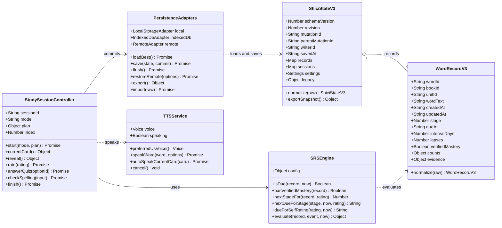
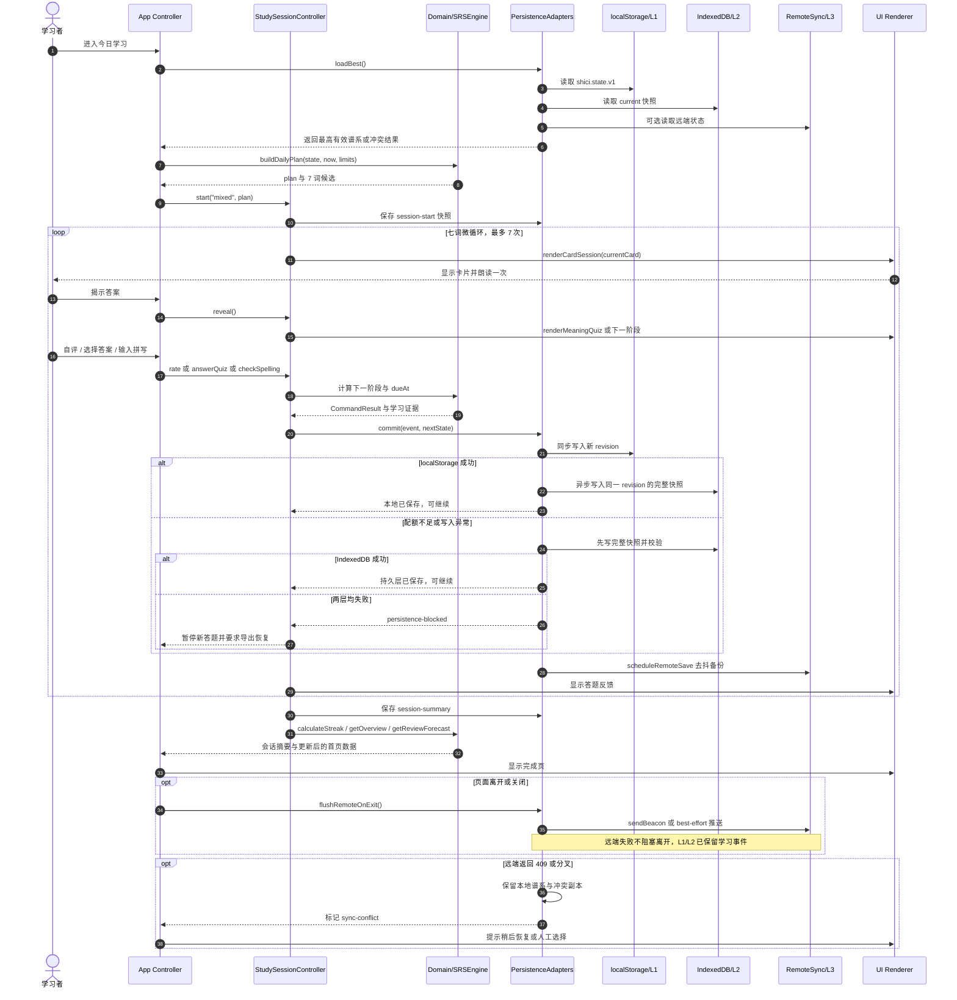
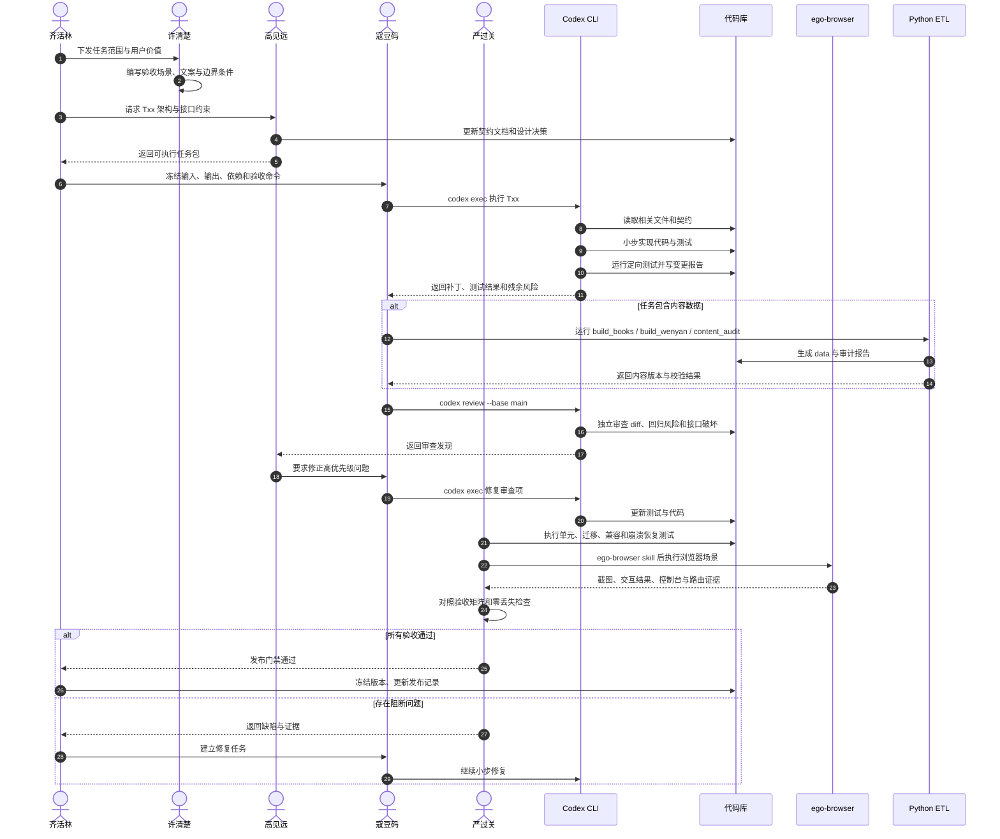

# 拾词（Shici）系统架构规划与 WorkBuddy × Codex 协同任务分工方案

> 文档口径：依据给定的文件规模、函数名与 Codex 方案起草；主理人随后直接核对了源码。当前 `window.Store` 实际导出 **65 个可调用成员、2 个 getter、6 个常量，共 73 个顶层成员**，而下文函数分层表只列举重点内部函数与部分公共函数，**不能当成完整公共 API 清单**；T01 必须自动提取全量成员、调用参数与返回值并冻结兼容测试。`js/app.js` 列举的函数大多是内部函数，并非已确认的公共 API。
>
> 执行口径：T01–T12 的新增文件和测试命令属于**计划中的目标产物**，不是当前仓库已经具备的能力。当前已有 `tools/check_project.py`、`tools/content_audit.py`（仅 `--json`/`--markdown`）、`tools/export_content_review.py`（`--check`/`--csv`/`--markdown`）、`tools/test_learning_system.sh`；`build_books.py` 暂无 `--check`，`build_wenyan.py` 暂无 CLI 选项。表中 `--strict`、`--output`、`tools/check_static.mjs` 等需先在相应任务中实现后再执行，不得复制为当前可用命令。
>
> 架构目标不是“增加一个构建系统”，而是在不引入 npm 运行时依赖、不打包、不转译的前提下，把当前的静态单页应用拆分为可测试、可迁移、可离线、可协同开发的分层结构，并保证 `shici.state.v1` 中已有学习数据可验证、可恢复。全存储失效、用户清站点数据等情形无法无条件承诺零丢失。

---

## 第一章 系统架构设计总览与零构建静态兼容选型

### 1.1 现有系统事实基线

拾词当前是一个典型的零构建静态 Web 应用，核心文件及规模如下：

| 文件 | 当前规模 | 当前职责 | 主要架构风险 |
|---|---:|---|---|
| `index.html` | 301 行 | 应用壳、静态入口、页面容器 | 入口脚本顺序和全局依赖隐含在 HTML 中 |
| `js/store.js` | 1657 行 | 状态、SRS、队列、统计、本地存储、IndexedDB、远端同步、导入导出 | 领域算法与持久化耦合，单文件承担过多边界 |
| `js/ui.js` | 1378 行 | 首页、学习中心、词库、书库、报告、会话卡片、抽屉、弹窗、搜索建议 | 页面渲染组件集中，难以独立做契约测试 |
| `js/app.js` | 2264 行 | 路由、页面装配、学习会话、答题、拼写、TTS、动作分发 | `handleAction` 约 430 行，动作入口集中且难以追踪 |
| `css/styles.css` | 9649 行 | 全站样式 | 页面样式、组件样式、覆盖规则、响应式规则相互影响 |
| `serve.py` | 245 行 | 本地静态服务器 | 承担 MIME、缓存、部署时的静态兼容义务 |
| `sw.js` | 95 行 | 离线缓存 | 需要与模块图、内容数据、缓存版本保持一致 |
| `tools/build_books.py` | 现有工具 | 词书内容构建 | 内容与运行时状态必须分离 |
| `tools/build_wenyan.py` | 现有工具 | 文言内容构建 | 需要稳定的输入输出契约 |
| `tools/content_audit.py` | 现有工具 | 内容审计 | 需要成为发布门禁 |
| `tools/export_content_review.py` | 现有工具 | 内容审阅导出 | 需要确定格式与可复现性 |
| `tools/test_learning_system.sh` | 现有工具 | 学习系统测试入口 | 需要扩展为统一验收入口 |

现有 `window.Store` 包含 65 个公共函数，`window.UI` 暴露页面渲染、会话渲染、抽屉、弹窗、搜索建议和辅助函数，`js/app.js` 至少包含 20 个关键函数。重构必须保留这些公共选择器，避免现有 HTML、历史路由、测试脚本和浏览器中缓存的旧页面同时失效。

### 1.2 架构决策

#### 决策一：原生 ES Modules，零构建，静态 HTTP 部署

采用浏览器原生 ES Modules：

- 不引入 Webpack、Vite、Rollup、TypeScript、Babel 或 npm 运行时依赖。
- 源码即部署物，不需要产物目录和 source map。
- 使用相对路径和显式 `.js` 扩展名，例如 `import { isDue } from "./domain/srs.js"`。
- `index.html` 最终只保留一个模块入口，依赖关系由 JS 导入图表达。
- Node.js 仅用于工具、测试和迁移脚本，不参与浏览器运行。

零构建的准确兼容边界如下：

| 兼容级别 | 运行方式 | 结论 |
|---|---|---|
| A | `python3 serve.py` 或任意静态 HTTP 服务器 | 完整支持，包含 IndexedDB、Service Worker、ES Modules |
| B | GitHub Pages、对象存储、Nginx、Caddy | 完整支持，要求正确 MIME 与缓存头 |
| C | `file://` 直接双击 `index.html` | 不作为完整功能目标；浏览器通常禁止 ES Module 加载 |
| D | 离线 PWA | 支持，但首次安装与 Service Worker 注册必须经过 HTTP(S) 或 localhost |

原因不是拾词需要构建，而是浏览器标准约束：Service Worker 和稳定的 IndexedDB origin 本身已经要求静态服务器；继续用全局脚本可支持 `file://`，但会牺牲依赖图清晰度、可测试性和模块边界。目标是“零构建 + 静态服务器”，不是“零服务器 + 多文件模块”。

#### 决策二：领域层纯函数化

SRS、今日计划、答题记录、错误分类、统计全部下沉为 `js/domain/` 纯函数：

- 输入：标准化状态、动作、当前时间。
- 输出：新状态、动作结果、派生统计、可观察副作用描述。
- 禁止访问 DOM、`localStorage`、IndexedDB、网络和 TTS。

这样可以让 SRS 与统计通过 Node 测试进行确定性验证，不再依赖浏览器初始化。

#### 决策三：存储适配器与业务协调器分离

- `localStorage` 是同步快速层。
- IndexedDB 是本地持久层和快照层。
- 远端接口是异步备份层。
- `PersistenceAdapters` 负责读写、比较、合并、隔离损坏数据。
- `StudySessionController` 只发出“提交学习事件”命令，不直接操作具体存储。

#### 决策四：状态与静态内容分离

- 静态内容：词书、文言内容、释义、例句、单元结构。
- 学习状态：用户对词的掌握情况、答题记录、会话、设置、统计索引。
- 运行时只保存 `wordId` 和学习证据，不在状态中复制整本词书。
- 内容通过 `contentVersion` 版本化，词书更新不覆盖用户学习记录。

#### 决策五：保留兼容壳，不在迁移期强行改名

对外保留：

- `window.Store` 的 65 个函数。
- `window.UI` 的现有页面与组件函数。
- `#/...` 哈希路由。
- `shici.state.v1` 的存储键名。
- 现有 `data-action` 交互约定。
- 现有导出 JSON 可导入。

内部允许替换实现，但不得破坏公共调用方式。

### 1.3 目标运行时结构

```text
浏览器
  ├─ index.html
  ├─ js/app.js                     兼容入口
  ├─ js/app/main.js                启动与装配
  ├─ js/store.js                   状态服务与兼容门面
  ├─ js/domain/                    SRS、计划、学习、统计
  ├─ js/storage/                   localStorage、IndexedDB、远端、导入导出
  ├─ js/ui/                        页面与组件渲染
  ├─ js/app/                       路由、动作、会话、TTS
  ├─ data/                         静态内容
  └─ sw.js                         离线缓存

工具链
  ├─ serve.py                      静态 HTTP
  ├─ tools/*.py                    内容 ETL、审计、审阅导出
  ├─ tools/*.mjs                   静态检查、迁移、Node 测试
  └─ tools/test_learning_system.sh 统一验收入口
```

运行时数据流：

```text
用户动作
  → App 动作分发
  → StudySessionController
  → Domain 纯函数计算
  → Store 提交状态
  → PersistenceAdapters 本地同步写入
  → IndexedDB 持久化
  → RemoteSync 异步备份
  → UI 接收新 ViewModel 后重绘
```

### 1.4 非功能原则

1. 离线优先：无网络时仍可完整学习、答题、统计和导出。
2. 数据优先：远端失败不得阻止本次学习，也不得导致本地数据被覆盖。
3. 确定性：同一状态、同一时刻、同一策略必须得到同一今日计划。
4. 可恢复：迁移、损坏、冲突都必须保留原始数据和恢复入口。
5. 可观测：每次保存有 `revision`、`mutationId`、`writerId` 和保存结果。
6. 可访问性：键盘操作、焦点恢复、ARIA 状态、减少动画与语音回退。
7. 安全：使用 HTML 转义，不把远端凭据写入状态或日志。
8. 部署简单：不要求构建缓存、manifest 打包或服务器端数据库。

---

## 第二章 目标分层文件树与模块职责边界

### 2.1 目标文件树

```text
.
├── package.json                         # 仅声明 type=module，无运行时依赖
├── index.html                           # 静态入口；只加载 js/app.js
├── serve.py                             # 静态服务器、MIME、缓存头
├── sw.js                                # 离线缓存与版本切换
├── cache-manifest.json                  # 零构建静态资源缓存清单
├── data/
│   ├── books.json                       # 词书内容索引
│   ├── wenyan.json                      # 文言内容
│   └── content-manifest.json            # 内容版本与校验信息
├── js/
│   ├── store.js                         # window.Store 兼容门面
│   ├── ui.js                            # window.UI 兼容门面
│   ├── app.js                           # 启动和 window.App 兼容入口
│   ├── domain/
│   │   ├── index.js
│   │   ├── schema.js
│   │   ├── srs.js
│   │   ├── planning.js
│   │   ├── learning.js
│   │   ├── stats.js
│   │   └── errors.js
│   ├── storage/
│   │   ├── index.js
│   │   ├── migrations.js
│   │   ├── state-integrity.js
│   │   ├── local-storage.js
│   │   ├── indexed-db.js
│   │   ├── remote-sync.js
│   │   ├── export-import.js
│   │   └── persistence.js
│   ├── ui/
│   │   ├── index.js
│   │   ├── render-home.js
│   │   ├── render-study-center.js
│   │   ├── render-library.js
│   │   ├── render-books.js
│   │   ├── render-report.js
│   │   ├── render-session.js
│   │   ├── word-drawer.js
│   │   ├── settings-drawer.js
│   │   ├── modal.js
│   │   ├── search-suggestions.js
│   │   └── helpers.js
│   └── app/
│       ├── main.js
│       ├── router.js
│       ├── chrome.js
│       ├── overlays.js
│       ├── sessions.js
│       ├── speech.js
│       ├── actions/
│       │   ├── index.js
│       │   ├── navigation.js
│       │   ├── learning.js
│       │   ├── library.js
│       │   └── settings.js
│       └── constants.js
├── css/
│   ├── styles.css                       # 唯一 CSS 入口，通过 @import 聚合
│   ├── tokens.css                       # 颜色、间距、字体、层级、动效变量
│   ├── base.css                         # reset、排版、可访问性基础
│   ├── layout.css                       # 应用壳、导航、内容宽度
│   ├── components/
│   │   ├── button.css
│   │   ├── card.css
│   │   ├── form.css
│   │   ├── drawer.css
│   │   ├── modal.css
│   │   ├── navigation.css
│   │   ├── session.css
│   │   └── progress.css
│   ├── pages/
│   │   ├── home.css
│   │   ├── study-center.css
│   │   ├── library.css
│   │   ├── books.css
│   │   ├── report.css
│   │   └── session.css
│   ├── overlays.css
│   ├── responsive.css
│   └── print.css
├── tools/
│   ├── build_books.py
│   ├── build_wenyan.py
│   ├── content_audit.py
│   ├── export_content_review.py
│   ├── check_static.mjs
│   ├── migrate_state.mjs
│   ├── test_learning_system.sh
│   ├── tests/
│   │   ├── compat/
│   │   ├── domain/
│   │   ├── storage/
│   │   ├── ui/
│   │   └── app/
│   ├── fixtures/
│   │   ├── state-v1.min.json
│   │   └── learning-golden.json
│   └── e2e/
│       └── run_shici_smoke.sh
└── docs/
    ├── architecture/
    ├── contracts/
    ├── migration/
    └── release/
```

### 2.2 依赖方向

允许的依赖方向：

```text
app  → domain + storage + ui
store → domain + storage
ui   → domain 的只读格式化类型（不得依赖 storage）
domain → 仅标准 JavaScript 数据
storage → domain 的 schema 与类型
```

禁止的依赖方向：

- `domain/` 访问 DOM、`window`、`localStorage`、`fetch`、`speechSynthesis`。
- `ui/` 直接调用 `Store.save()`、IndexedDB、远端接口或修改 SRS 字段。
- `storage/` 读取页面 DOM 或决定页面跳转。
- `tools/` 在运行时被 `index.html` 加载。
- 页面模块在导入阶段执行副作用，例如立即写存储或注册多份事件。

### 2.3 各层职责

| 层 | 核心职责 | 输入 | 输出 | 禁止事项 |
|---|---|---|---|---|
| `js/domain/` | SRS 阶段、复习队列、评分、答题、统计、数据规范化 | 状态、学习事件、当前时间、策略常量 | 新状态或只读派生结果 | 不得持久化、渲染、联网 |
| `js/storage/` | 状态读写、迁移、快照、冲突、远端同步、导入导出 | 状态快照、版本、远端应答 | `LoadResult`、`SaveAck`、冲突结果 | 不得改变学习算法 |
| `js/ui/` | HTML 字符串、视图组件、焦点与 ARIA 标记 | ViewModel | 可挂载 HTML 片段 | 不得写 Store，不得自行决定 SRS |
| `js/app/` | 路由、动作分发、会话编排、TTS、页面装配 | URL、用户动作、Store/UI 接口 | 命令、页面渲染、持久化请求 | 不得绕过 Store 直接写 IndexedDB |
| `js/store.js` | 组合领域与存储，提供 `window.Store` 兼容 65 接口 | App 命令 | 状态、统计、持久化应答 | 不得重新膨胀为业务总仓 |
| `css/` | 设计令牌、布局、组件、页面、响应式和打印 | DOM 结构与类名 | 样式层叠 | 不得依赖 JS 内联样式完成核心布局 |
| `tools/` | 内容 ETL、审计、迁移、静态检查、测试 | 原始内容、源码、夹具 | 静态数据、报告、退出码 | 不得修改浏览器运行时状态 |

### 2.4 现有函数到目标模块的映射

#### 重点函数的分层映射（非全量公共 API）

以下列有内部函数和部分已导出的函数，不代表 65 个可调用成员的完整清单；以 T01 从 `window.Store` 自动提取的 73 个顶层成员为兼容基线。

| 目标模块 | 现有函数去向示例 |
|---|---|
| `js/domain/schema.js` | `createDefaultState`, `normalizeRecord` |
| `js/storage/persistence.js` | `load`, `save`, `getPersistence`, `getStatus` |
| `js/storage/indexed-db.js` | `openIndexedDb`, `writeIndexedDb`, `hydrateFromIndexedDb` |
| `js/storage/remote-sync.js` | `prepareRemote`, `scheduleRemoteSave`, `flushRemoteOnExit`, `pushRemoteNow`, `restoreRemoteState` |
| `js/storage/export-import.js` | `exportState`, `importState` |
| `js/domain/srs.js` | `isDue`, `hasVerifiedMastery`, `nextStageFor`, `nextDueForStage`, `dueForSelfRating` |
| `js/domain/planning.js` | `buildDailyPlan`, `buildNewQueue`, `buildReviewQueue`, `buildMixedQueue`, `learnedReviewWords` |
| `js/domain/learning.js` | `answerWord`, `classifySpellingError`, `recordObjectiveAnswer`, `recordSessionQuizAnswer`, `markMastered` |
| `js/domain/stats.js` | `unitStats`, `calculateStreak`, `totalStats`, `getWeekSeries`, `getHeatmap`, `getReviewForecast`, `getOverview` |

#### `window.UI` 的目标映射

| 目标模块 | 保留函数 |
|---|---|
| `render-home.js` | `renderHome` |
| `render-study-center.js` | `renderStudyCenter` |
| `render-library.js` | `renderLibrary` |
| `render-books.js` | `renderBooks` |
| `render-report.js` | `renderReport` |
| `render-session.js` | `renderSession`, `renderCardSession`, `renderMeaningQuiz`, `renderSpelling` |
| `word-drawer.js` | `wordDrawer` |
| `settings-drawer.js` | `settingsDrawer` |
| `modal.js` | `modal` |
| `search-suggestions.js` | `searchSuggestions` |
| `helpers.js` | 现有辅助函数；新增统一 `escapeHtml`、`formatInstant`、`dayKey`、`classNames` |

#### `js/app.js` 的目标映射

| 目标模块 | 保留函数 |
|---|---|
| `js/app/router.js` | `parseHash`, `navigate`, `handleHashChange`, `renderPage` |
| `js/app/chrome.js` | `renderChrome` |
| `js/app/overlays.js` | `renderOverlays` |
| `js/app/sessions.js` | `startSession`, `startSpellingSession`, `startRetrievalSession`, `revealCard`, `rateCard`, `startSessionQuiz`, `answerQuizOption`, `finishSessionQuiz`, `checkSpelling`, `finishSpellingSession` |
| `js/app/speech.js` | `preferredUsVoice`, `speakWord`, `autoSpeakCurrentCard` |
| `js/app/actions/` | `handleAction` 保留一个入口，内部按 `data-action` 路由到小型动作处理器 |
| `js/app/main.js` | 启动、初始化 Store、装配 UI、注册页面事件和 Service Worker |

### 2.5 `handleAction` 的拆分原则

不改变外部 `data-action` 协议，只把约 430 行的集中式分支拆成注册表：

```text
handleAction(action, payload, event)
  ├─ navigation.*   → parseHash / navigate / 页面切换
  ├─ learning.*     → sessions / reveal / rate / quiz / spelling
  ├─ library.*      → 词库筛选、收藏、搜索
  └─ settings.*     → 设置、导入导出、语音、同步
```

每个动作处理器：

- 名字必须唯一。
- 必须有 `async` 或同步返回的统一 `ActionResult`。
- 必须在入口处防止重复点击。
- 必须返回持久化状态或显式失败。
- 不得在动作处理器内重复实现 SRS 规则。

### 2.6 CSS 分层原则

`css/styles.css` 继续作为唯一样式入口：

```css
@import url("./tokens.css");
@import url("./base.css");
@import url("./layout.css");
@import url("./components/button.css");
/* 其他组件、页面和响应式文件 */
```

使用 CSS 自定义属性和原生层叠层：

```css
@layer tokens, base, layout, components, pages, overlays, utilities;
```

迁移约束：

- 现有类名在功能验收前不批量改名。
- 新组件优先使用 `data-*` 状态属性。
- 焦点环、减少动画、颜色对比、触控尺寸统一进入 `base.css` 和 `tokens.css`。
- 不把页面业务状态编码成只有颜色变化、没有文字或 `aria-*` 的状态。
- 样式拆分后必须检查级联顺序与移动端布局，不能只检查文件是否存在。

---

## 第三章 数据结构与核心接口设计

### 3.1 数据边界

拾词的数据分为三类：

1. 静态内容：词书、释义、例句、单元和内容版本，位于 `data/`。
2. 用户状态：学习记录、复习证据、会话、设置、统计索引，位于 `shici.state.v1`。
3. 运行时临时状态：当前会话、当前抽屉、语音播放状态，通常不持久化，必要时写入会话快照。

### 3.2 状态信封与版本控制

存储键继续使用：

```text
shici.state.v1
```

存储键中的 `v1` 是历史兼容键名，不随内部 `schemaVersion` 改变。内部状态使用 `ShiciStateV3`，当前目标版本为 3。

建议的持久化信封：

```json
{
  "schemaVersion": 3,
  "stateId": "state-...",
  "revision": 42,
  "mutationId": "mut-...",
  "parentMutationId": "mut-...",
  "writerId": "tab-...",
  "savedAt": "2026-11-22T00:00:00.000Z",
  "checksum": "non-cryptographic-integrity-check",
  "data": {
    "records": {},
    "sessions": {},
    "settings": {},
    "derived": {},
    "migration": {},
    "legacy": {}
  }
}
```

字段约定：

- `schemaVersion`：内部结构版本，不是存储键版本。
- `revision`：每次成功提交递增。
- `mutationId`：本次提交唯一 ID，用于幂等和去重。
- `parentMutationId`：支持检测并发分叉。
- `writerId`：当前浏览器标签页或设备实例。
- `checksum`：用于发现损坏和部分写入，不承担安全签名职责。
- `legacy`：保存迁移时无法识别但必须保留的字段。

### 3.3 `ShiciStateV3`

```text
ShiciStateV3
├─ schemaVersion: 3
├─ revision: number
├─ mutationId: string
├─ parentMutationId: string | null
├─ writerId: string
├─ savedAt: ISO8601 string
├─ data.records: Map<wordId, WordRecordV3>
├─ data.sessions: Map<sessionId, SessionRecord>
├─ data.settings: UserSettings
├─ data.derived: DerivedCache
├─ data.migration: MigrationInfo
└─ data.legacy: unknown
```

不可破坏的不变量：

- `records` 的键与 `WordRecordV3.wordId` 一致。
- 时间戳统一保存为 UTC ISO 字符串。
- `dueAt` 使用 UTC；今日计划和热力图使用用户本地日界线。
- `revision` 严格单调递增，除并发冲突外不得回退。
- 统计以记录和学习历史为事实基础，缓存字段不能成为唯一真相。
- 静态词书内容不得写入记录正文的唯一定义来源。
- 未知字段迁移时进入 `legacy`，不得静默删除。

### 3.4 `WordRecordV3`

```text
WordRecordV3
├─ wordId
├─ bookId
├─ unitId
├─ wordText
├─ normalizedText
├─ createdAt
├─ updatedAt
├─ srs
│  ├─ stage
│  ├─ dueAt
│  ├─ intervalDays
│  ├─ lastRating
│  ├─ lastReviewedAt
│  ├─ lapses
│  ├─ verifiedMastery
│  └─ masterySource
├─ counts
│  ├─ seen
│  ├─ objectiveCorrect
│  ├─ objectiveTotal
│  ├─ spellingCorrect
│  ├─ spellingAttempts
│  └─ selfRatings
├─ flags
│  ├─ bookmarked
│  └─ suspended
└─ evidence
   ├─ lastObjectiveResult
   ├─ lastSpellingResult
   └─ recentErrors
```

掌握判定必须区分：

- 用户手动标记的掌握。
- 客观题与拼写证据形成的“已验证掌握”。

因此：

- `markMastered` 记录 `masterySource = "user"`。
- `hasVerifiedMastery` 只依据可验证证据和当前策略，不得只因用户点击一次“已掌握”而永久为真。
- 具体阶段间隔、评分映射和验证阈值必须从现有 `nextDueForStage`、`dueForSelfRating`、`hasVerifiedMastery` 的行为夹具中提取，不能在重构时临时发明新数值。

### 3.5 类图



### 3.6 Domain 冻结接口

以下接口在 `window.Store` 内部调用，T01 负责把现有参数适配到该契约；对外兼容函数仍保留原调用方式。

```js
/**
 * @param {Date|string} [now]
 * @returns {ShiciStateV3}
 */
createDefaultState(now)

/**
 * @param {unknown} rawRecord
 * @param {{ bookId?: string, unitId?: string, now?: Date }} context
 * @returns {WordRecordV3}
 */
normalizeRecord(rawRecord, context)

/**
 * @param {WordRecordV3} record
 * @param {Date} now
 * @returns {boolean}
 */
isDue(record, now)

/**
 * @param {WordRecordV3} record
 * @returns {boolean}
 */
hasVerifiedMastery(record)

/**
 * @param {WordRecordV3} record
 * @param {"again"|"hard"|"good"|"easy"} rating
 * @returns {number}
 */
nextStageFor(record, rating)

/**
 * @param {number} stage
 * @param {Date} from
 * @param {"again"|"hard"|"good"|"easy"} rating
 * @returns {string}
 */
nextDueForStage(stage, from, rating)

/**
 * @param {"again"|"hard"|"good"|"easy"} rating
 * @param {Date} now
 * @returns {string}
 */
dueForSelfRating(rating, now)
```

今日计划与队列：

```js
buildDailyPlan(state, { now, limits })
buildNewQueue(state, plan, now)
buildReviewQueue(state, plan, now)
buildMixedQueue(state, plan, now)
learnedReviewWords(state, now)
```

学习事件：

```js
answerWord(state, { wordId, input, mode, sessionId }, { now })
classifySpellingError(expected, actual)
recordObjectiveAnswer(state, { wordId, answer, correct, sessionId }, { now })
recordSessionQuizAnswer(state, { sessionId, wordId, optionId, correct }, { now })
markMastered(state, { wordId, source, sessionId }, { now })
```

统一返回目标形状：

```text
CommandResult
├─ state: ShiciStateV3
├─ changed: boolean
├─ record: WordRecordV3 | null
├─ result: LearningResult | null
├─ effects: Effect[]
└─ audit: AuditEntry
```

`Effect` 只描述“需要做什么”，例如 `speak`, `persist`, `closeOverlay`, `showToast`，由 App 层执行。

统计接口：

```js
unitStats(state, { bookId, unitId, now })
calculateStreak(state, { now, timeZone })
totalStats(state, { now })
getWeekSeries(state, { now, timeZone })
getHeatmap(state, { now, days, timeZone })
getReviewForecast(state, { now, days })
getOverview(state, { now, timeZone })
```

统计规则：

- 周序列默认从周一开始，具体是否保持现有行为由 T01 夹具确认。
- 热力图按用户本地日期聚合。
- `getReviewForecast` 对未来到期数做按日分桶。
- `getOverview` 只组合统计结果，不直接修改记录。

### 3.7 持久化接口

```js
createDefaultState(now)
load(options)
save(nextState, commit)
openIndexedDb()
writeIndexedDb(snapshot)
hydrateFromIndexedDb()
prepareRemote(config)
scheduleRemoteSave(state, delayMs)
flushRemoteOnExit()
pushRemoteNow(state)
restoreRemoteState(options)
exportState(state)
importState(rawJson)
getPersistence()
getStatus()
```

接口语义：

| 接口 | 目标语义 |
|---|---|
| `load` | 优先返回可解析的同步本地状态，并启动 IDB/远端校验 |
| `save` | 先完成至少一个本地持久层写入，再确认本次动作已保存 |
| `openIndexedDb` | 返回数据库对象；失败必须显式返回 unavailable |
| `writeIndexedDb` | 写入带 revision、mutationId、checksum 的快照 |
| `hydrateFromIndexedDb` | 与本地状态比较 revision 和分叉关系，不盲目覆盖 |
| `prepareRemote` | 配置端点、超时、是否启用；不存储秘密 |
| `scheduleRemoteSave` | 去抖合并，不丢失最终版本 |
| `flushRemoteOnExit` | 使用 `sendBeacon` 或等价 best-effort 机制；远端失败不影响本地 |
| `pushRemoteNow` | 显式推送并返回远端 revision |
| `restoreRemoteState` | 只在用户确认或新设备空状态时执行 |
| `exportState` | 输出完整、可复验、可重新导入的状态 |
| `importState` | 先验证、备份、再迁移；失败不改写现有状态 |
| `getPersistence` | 返回 local、IDB、remote 的能力和当前状态 |
| `getStatus` | 返回最近保存、待同步、冲突和容量信息 |

### 3.8 `StudySessionController`

```text
start(mode, plan)
currentCard()
reveal()
rate(rating)
startSessionQuiz()
answerQuiz(optionId)
checkSpelling(input)
finish()
```

状态机：

```text
idle
  → loading
  → showing
  → revealed
  → rated
  → quiz
  → spelling
  → next-card
  → completed
  → persisted
```

约束：

- 未揭示前不得接受评分。
- 每道题只能提交一次；重复提交必须由 `mutationId` 或控制器状态去重。
- 每次回答成功写入本地后，才进入下一词。
- 完成会话后先持久化会话摘要，再显示统计。
- 页面刷新后可从当前会话快照恢复，但不得伪造未完成的答题事件。

### 3.9 `TTSService`

```js
preferredUsVoice()
speakWord(word, options)
autoSpeakCurrentCard(card)
cancel()
```

实现原则：

- 使用浏览器 `speechSynthesis` 和 `SpeechSynthesisUtterance`。
- `voiceschanged` 事件后重新选择美式英语声音。
- TTS 不可用时返回明确状态，不影响学习流程。
- 自动朗读每张卡最多触发一次。
- 手动播放优先于自动播放。
- 移动端需要用户手势时，显示可操作播放按钮。
- 切换卡片、离开会话或关闭抽屉时取消上一段语音。

### 3.10 UI 接口

```js
renderHome(viewModel)
renderStudyCenter(viewModel)
renderLibrary(viewModel)
renderBooks(viewModel)
renderReport(viewModel)
renderSession(viewModel)
renderCardSession(viewModel)
renderMeaningQuiz(viewModel)
renderSpelling(viewModel)
wordDrawer(viewModel)
settingsDrawer(viewModel)
modal(viewModel)
searchSuggestions(viewModel)
```

目标约定：

- UI 返回转义后的 HTML 字符串，由 App 统一挂载。
- 所有动态文本必须经过 `escapeHtml`。
- 交互只使用带 `data-action` 和 `data-*` 的元素，不内联业务脚本。
- UI 不调用 Store，不直接持久化，不决定复习阶段。
- 可访问状态包括 `aria-expanded`、`aria-live`、`aria-current`、焦点恢复和键盘可达性。

### 3.11 App 接口

```js
parseHash(hash)
navigate(target, { replace })
handleHashChange(event)
renderPage(route)
renderChrome()
renderOverlays()
startSession(mode)
startSpellingSession()
startRetrievalSession()
revealCard()
rateCard(rating)
startSessionQuiz()
answerQuizOption(optionId)
finishSessionQuiz()
checkSpelling()
finishSpellingSession()
preferredUsVoice()
speakWord(word, options)
autoSpeakCurrentCard(card)
handleAction(actionName, payload, sourceEvent)
```

`handleAction` 是所有 DOM 动作的兼容总入口；内部必须按领域拆分为小处理器，且不得超过 50 行核心分发逻辑。

---

## 第四章 核心业务与双智能体协同流程

### 4.1 学习核心模型

拾词的核心闭环是：

```text
内容载入
  → 今日计划
  → 新词队列 / 复习队列 / 混合队列
  → 七词微循环
  → 揭示、自评、客观题、拼写
  → 记录学习证据
  → 计算下一次到期
  → 完成会话
  → 汇总统计
  → 更新明日预测
```

#### 4.1.1 今日计划

`buildDailyPlan` 的目标输入：

- 当前状态。
- 当前本地日期和时刻。
- 新词上限。
- 复习上限。
- 会话容量。
- 用户选择的词书和单元。
- 已暂停、已掌握、无内容记录的处理策略。

计划必须是确定性的。同一天、同一状态重复渲染，不应随机换词。计划中保存实际选中的 `wordId` 列表，避免页面刷新后队列变化。

#### 4.1.2 三类队列

- `buildNewQueue`：从未学习或缺少有效学习证据的词。
- `buildReviewQueue`：已到期、低掌握、最近出错或需要验证的旧词。
- `buildMixedQueue`：按计划容量交错安排新词与复习词，防止连续同类型造成疲劳。
- `learnedReviewWords`：返回可用于复习、但仍未完全掌握的旧词集合。

排序建议：

1. 已到期且有近期错误的词。
2. 已到期旧词。
3. 用户当前单元中新词。
4. 其他单元新词。
5. 相同排序分数时按稳定 ID 排序。

#### 4.1.3 七词微循环

每 7 个词构成一个短循环：

1. 从 `buildMixedQueue` 取最多 7 个词。
2. 每个词先显示正面卡片。
3. 自动朗读一次；TTS 不可用不影响流程。
4. 用户揭示答案。
5. 用户进行 `again / hard / good / easy` 自评。
6. 根据当前设置显示词义选择题。
7. 进入需要拼写的阶段时显示拼写题。
8. 每次回答立即写入学习事件，不等待整个会话结束。
9. 第 7 个词完成后显示本循环摘要。
10. 继续下一循环或完成今日会话。

重要规则：

- 一个词可以既有自评，也有客观题和拼写证据。
- “已验证掌握”需要客观证据；单纯自评只影响调度。
- `classifySpellingError` 必须能区分至少“空输入、大小写差异、轻微拼写错误、明显错误”等可观察类别；具体类别以现有行为夹具冻结。
- 所有答题操作必须幂等，重复事件不得增加两次正确数。

#### 4.1.4 统计口径

- `unitStats`：单元内学习数、复习数、掌握数、到期数。
- `calculateStreak`：按本地日界线计算连续学习天数。
- `totalStats`：全局待学、学习中、已到期、已验证掌握。
- `getWeekSeries`：每日新学、复习、正确率和时长摘要。
- `getHeatmap`：按日期聚合学习活动。
- `getReviewForecast`：未来若干天的到期量。
- `getOverview`：面向首页和报告的总览 ViewModel。

统计不从 UI 反推，不从缓存单独计算；缓存失效时可从记录和会话摘要重建。

### 4.2 七词微循环与三层防丢持久化时序图



### 4.3 WorkBuddy × Codex 协同研发流水线时序图



### 4.4 关键失败分支

| 场景 | 处理 |
|---|---|
| 远端断网 | 本地照常保存；显示待同步；不重复弹窗 |
| IndexedDB 打开失败 | localStorage 继续工作；状态栏明确标记 L2 不可用 |
| localStorage 配额不足 | 必须成功写入 IDB 后才允许继续答题 |
| 两层本地存储均失败 | 暂停写入型动作，保留内存状态，提示导出 |
| 状态 JSON 损坏 | 原文隔离到 quarantine 键，不覆盖损坏数据 |
| 多标签同时答题 | Web Locks 或 storage 事件检测；分叉保留两侧快照 |
| 远端 409 | 不自动让远端覆盖本地；生成冲突副本 |
| TTS 无声音 | 显示播放按钮；学习流程不失败 |
| 内容清单版本变化 | 只更新静态内容，不重写学习记录 |
| 重复点击提交 | 动作禁用 + `mutationId` 去重 |

---

## 第五章 WorkBuddy 团队 × 本机 Codex CLI 深度协同分工矩阵

### 5.1 角色定义

| 角色 | 定位 | 主要责任 | 不负责 |
|---|---|---|---|
| 齐活林 | 项目组织者与集成负责人 | 范围、依赖、任务包、合并窗口、发布签字 | 不替代架构师和质量门禁做单方面技术结论 |
| 许清楚 | 产品与体验负责人 | 用户目标、信息架构、验收场景、文案、边界交互 | 不直接修改 SRS 常数或存储结构 |
| 高见远 | 系统架构与算法负责人 | 分层、状态契约、SRS 证据模型、迁移策略、技术评审 | 不绕过 QA 直接发布 |
| 寇豆码 | 工程实现与 Codex 操作人 | 将任务包交给 Codex、审查补丁、整合、处理冲突 | 不擅自扩大范围或修改公共契约 |
| 严过关 | 质量与发布门禁负责人 | 测试矩阵、迁移演练、浏览器验证、零丢失检查 | 不因“功能看起来可用”降低数据安全门槛 |
| Codex CLI | 实现与审计执行器 | 代码修改、测试、Python ETL、静态审查、浏览器辅助 QA | 不拥有产品决策权，不单独拥有发布签字权 |

### 5.2 RACI 分工矩阵

R：执行；A：最终负责；C：需咨询；I：知会。

| 工作项 | 齐活林 | 许清楚 | 高见远 | 寇豆码 | 严过关 | Codex CLI |
|---|---|---|---|---|---|---|
| 基线与范围冻结 | A/R | C | C | C | C | R |
| 用户场景与验收标准 | C | A/R | C | C | C | C |
| 分层架构与状态契约 | C | C | A/R | R | C | R |
| SRS、计划和统计算法 | I | C | A | R | C | R |
| `shici.state.v1` 迁移 | I | C | A | R | R | R |
| 本地与 IndexedDB 持久化 | I | I | A | R | R | R |
| 远端同步与冲突处理 | I | C | A | R | R | R |
| Store 兼容门面 | I | I | A | R | R | R |
| UI 页面拆分 | I | C | C | A/R | C | R |
| CSS 分层与响应式 | I | A | C | R | C | R |
| App 路由与动作拆分 | I | C | C | A/R | C | R |
| TTS 与无障碍 | I | A | C | R | R | R |
| Python 内容 ETL | I | C | C | R | C | R |
| 单元和兼容测试 | I | C | C | R | A/R | R |
| `codex review` 独立审查 | I | C | C | R | A | R |
| ego-browser 功能与视觉 QA | I | A | C | C | R | R |
| 迁移演练与零丢失审计 | I | I | C | R | A/R | R |
| 发布冻结与回滚文档 | A/R | C | C | R | R | C |
| 最终发布批准 | A | C | C | I | R | I |

核心原则：

- Codex 可以有大量 `R`，但不得拥有任何 `A`。
- 高见远对算法、状态契约和迁移方案负架构责任。
- 严过关对“数据是否可能丢失”拥有一票否决权。
- 许清楚对用户可理解性和验收场景负责，不把“技术上通过”当作产品通过。
- 齐活林负责让不同代理不并行修改同一文件而互相覆盖。

### 5.3 文件协同所有权

| 文件域 | 主编辑方 | 必须评审方 |
|---|---|---|
| `js/domain/*` | 高见远 + 寇豆码 | 严过关 |
| `js/storage/*` | 高见远 + 寇豆码 | 严过关 |
| `js/store.js` | 寇豆码 | 高见远、严过关 |
| `js/ui/*`、`js/ui.js` | 寇豆码 | 许清楚、严过关 |
| `css/*` | 寇豆码 | 许清楚、严过关 |
| `js/app/*`、`js/app.js` | 寇豆码 | 高见远、严过关 |
| `index.html`、`serve.py`、`sw.js` | 寇豆码 | 严过关 |
| `tools/*.py` | 寇豆码 + Codex | 许清楚、严过关 |
| `docs/contracts/*` | 高见远 | 齐活林 |
| `docs/release/*` | 严过关 | 齐活林 |

同一时间只允许一个主编辑方修改同一文件域。Codex 修复期间，其他成员不得对相同文件做手工并行编辑。

### 5.4 Codex CLI 使用边界

#### `codex exec`

适用：

- 按 T01-T12 小任务生成补丁。
- 新增或修改测试。
- 把重复逻辑迁入纯函数。
- 生成迁移脚本。
- 拆分 UI 与动作处理器。
- 生成 Python 内容检查代码。

任务包必须写明：

```text
任务编号：Txx
目标：一句话业务结果
允许修改：精确文件列表
禁止修改：公共契约、无关样式、生成数据
输入：依赖文件与契约
输出：代码、测试、文档
验收命令：可复制的命令列表
失败处理：不得静默改接口，必须返回残余风险
```

#### `codex review`

适用：

- T02 状态结构与迁移。
- T03 SRS 与计划。
- T04-T05 持久化与远端冲突。
- T06 Store 兼容门禁。
- T10 路由与动作重构。
- 发布前整体 diff。

Review 必须检查：

- 公共函数是否缺失或签名破坏。
- 是否引入打包或运行时依赖。
- 是否存在状态被远端覆盖、迁移失败写入半成品、重复计数。
- 是否存在 UI 直接写存储。
- 是否保留 `shici.state.v1`。
- 是否有跨标签冲突和页面退出路径。
- 是否测试了正常、失败、恢复三条路径。

#### Python ETL

Python 只处理内容，不直接改用户学习状态：

- `build_books.py`：构建词书数据。
- `build_wenyan.py`：构建文言数据。
- `content_audit.py`：重复词、缺字段、非法 ID、无释义、无例句等检查。
- `export_content_review.py`：导出可审阅清单。

工具要求：

- 输出稳定排序。
- 明确退出码。
- 写出内容版本和摘要。
- 不允许网络请求作为构建必要步骤。
- 不得覆盖未经备份的原始内容。

#### ego-browser

浏览器工作前先执行并阅读：

```bash
ego-browser skill
```

再执行：

- 首页、学习中心、词库、书库、报告路由切换。
- 七词微循环完整交互。
- 刷新中途会话恢复。
- 断网后学习与重新联网。
- 词义选择题和拼写题重复提交。
- 设置抽屉、词条抽屉、弹窗、搜索建议。
- 移动端布局、键盘焦点、ARIA 状态和减少动画。
- 导入导出与迁移后页面可读性。

ego-browser 产出的截图、控制台错误、路由结果和交互证据进入 `docs/release/acceptance-report.md`。

### 5.5 推荐协同命令

以下命令是后续任务执行命令，不是当前文档生成动作：

```bash
codex exec "执行 T03，只修改 js/domain/srs.js、js/domain/planning.js、js/domain/learning.js、js/domain/stats.js 和 tools/tests/domain，保持 window.Store 公共名称不变，运行 node --test tools/tests/domain"
```

```bash
codex review --base main
```

```bash
python3 tools/build_books.py --check
python3 tools/build_wenyan.py --check
python3 tools/content_audit.py --strict
python3 tools/export_content_review.py --output data/content-review.json
```

```bash
ego-browser skill
```

如果上述工具参数与现有版本不一致，T01 必须记录实际帮助输出并更新本文命令，而不是让执行者临场猜测。

---

## 第六章 有序任务分解表（T01-T12）

> 表中验收命令均为任务完成后的门禁命令。T11 统一固化工具参数；若现有 Python 工具已有等价参数，则使用兼容别名并保留本表列出的稳定入口。

| 编号 | 目标与范围 | 前驱 | 执行方 | 精确输入文件 | 精确输出文件 | 验收命令 | 完成门 |
|---|---|---|---|---|---|---|---|
| T01 | 冻结公共 API、路由、动作、状态键和现有行为基线 | 无 | 齐活林、严过关、Codex；高见远咨询 | `index.html`、`js/store.js`、`js/ui.js`、`js/app.js`、`css/styles.css`、`serve.py`、`sw.js`、`tools/*` | `docs/architecture/baseline.md`、`docs/contracts/public-api.md`、`docs/contracts/routes-actions.md`、`tools/check_static.mjs`、`tools/fixtures/state-v1.min.json`、`tools/tests/compat/baseline-api.test.mjs` | `node tools/check_static.mjs --baseline`；`node --test tools/tests/compat/baseline-api.test.mjs` | Store 65 接口、UI 入口、App 关键函数、哈希路由、`shici.state.v1` 全部有基线证据；夹具已脱敏；无未记录公共 API |
| T02 | 建立 `ShiciStateV3`、`WordRecordV3`、迁移与状态校验 | T01 | 高见远、寇豆码、严过关、Codex | T01 契约与夹具、`tools/fixtures/state-v1.min.json` | `js/domain/schema.js`、`js/domain/errors.js`、`js/storage/migrations.js`、`js/storage/state-integrity.js`、`tools/migrate_state.mjs`、`tools/tests/domain/schema.test.mjs`、`tools/tests/storage/migrations.test.mjs`、`docs/contracts/state-v3.md` | `node --test tools/tests/domain/schema.test.mjs tools/tests/storage/migrations.test.mjs`；`node tools/migrate_state.mjs --in tools/fixtures/state-v1.min.json --out /tmp/shici-v3.json --roundtrip` | 迁移幂等；未知字段保留；损坏 JSON 不覆盖原文；v1 夹具往返后用户数据等价；无静默删除 |
| T03 | 提取 SRS、今日计划、学习事件、统计纯函数 | T02 | 高见远、寇豆码、Codex；许清楚验收规则 | `js/domain/schema.js`、T01 行为夹具、`tools/fixtures/learning-golden.json` | `js/domain/srs.js`、`js/domain/planning.js`、`js/domain/learning.js`、`js/domain/stats.js`、`js/domain/index.js`、`tools/tests/domain/srs.test.mjs`、`tools/tests/domain/planning.test.mjs`、`tools/tests/domain/learning.test.mjs`、`tools/tests/domain/stats.test.mjs` | `node --test tools/tests/domain` | 现有阶段、间隔、评分、队列和统计行为由 golden tests 锁定；重复答题不重复计数；同状态同时刻计划确定 |
| T04 | 实现 localStorage、IndexedDB、完整性校验与三层协调 | T02 | 高见远、寇豆码、严过关、Codex | `js/domain/schema.js`、`js/domain/errors.js`、`js/storage/state-integrity.js`、T02 契约 | `js/storage/local-storage.js`、`js/storage/indexed-db.js`、`js/storage/persistence.js`、`js/storage/index.js`、`tools/tests/storage/local-storage.test.mjs`、`tools/tests/storage/indexed-db-contract.test.mjs`、`tools/tests/storage/quota-fallback.test.mjs` | `node --test tools/tests/storage/local-storage.test.mjs tools/tests/storage/indexed-db-contract.test.mjs tools/tests/storage/quota-fallback.test.mjs` | 本地成功、IDB 成功、配额失败、双层失败、损坏隔离均有测试；任何继续学习路径至少有一层持久化成功 |
| T05 | 实现远端同步、冲突保留、导入导出与退出刷新 | T04 | 高见远、寇豆码、严过关、Codex | `js/storage/persistence.js`、`js/storage/state-integrity.js`、T01 公共 API 契约 | `js/storage/remote-sync.js`、`js/storage/export-import.js`、`tools/tests/storage/remote-sync.test.mjs`、`tools/tests/storage/export-import.test.mjs`、`docs/contracts/remote-sync.md` | `node --test tools/tests/storage/remote-sync.test.mjs tools/tests/storage/export-import.test.mjs` | 远端不可用不丢本地；409 不自动覆盖；退出刷新 best-effort；导出后可重新导入；敏感凭据不入状态 |
| T06 | 重建 `js/store.js` 兼容门面并接入领域、存储模块 | T03、T04、T05 | 寇豆码、高见远、严过关、Codex | `js/domain/index.js`、`js/storage/index.js`、`docs/contracts/public-api.md` | `js/store.js`、`tools/tests/compat/store-api.test.mjs`、`tools/tests/compat/load-save.test.mjs`、`docs/contracts/store-facade.md` | `node --test tools/tests/compat/store-api.test.mjs tools/tests/compat/load-save.test.mjs` | `window.Store` 65 个函数全部存在；历史调用方式通过基线测试；Store 不再承载新业务实现 |
| T07 | 拆分 CSS 设计令牌、布局、基础组件和页面骨架 | T01、T06 | 寇豆码、许清楚、严过关、Codex | `css/styles.css`、`index.html` 的现有类名、T01 视觉基线 | `css/styles.css`、`css/tokens.css`、`css/base.css`、`css/layout.css`、`css/components/navigation.css`、`css/components/card.css`、`css/components/button.css`、`css/components/form.css`、`css/responsive.css`、`tools/tests/ui/css-contract.test.mjs` | `node tools/check_static.mjs --styles`；`node --test tools/tests/ui/css-contract.test.mjs` | 首页、导航、学习中心、词库、书库、报告无布局破坏；焦点环、减少动画和响应式规则存在；无重复覆盖大块 |
| T08 | 拆分普通页面渲染器与 UI 兼容门面 | T07、T03、T06 | 寇豆码、许清楚、严过关、Codex | `js/ui.js`、`css/pages/*`、Store 只读 ViewModel 契约 | `js/ui/render-home.js`、`js/ui/render-study-center.js`、`js/ui/render-library.js`、`js/ui/render-books.js`、`js/ui/render-report.js`、`js/ui/helpers.js`、`js/ui/index.js`、`js/ui.js`、`css/pages/home.css`、`css/pages/study-center.css`、`css/pages/library.css`、`css/pages/books.css`、`css/pages/report.css`、`tools/tests/ui/pages.test.mjs`、`tools/tests/ui/html-escaping.test.mjs` | `node --test tools/tests/ui/pages.test.mjs tools/tests/ui/html-escaping.test.mjs` | 五个普通页面与首页渲染输出通过场景夹具；动态文本全部转义；`window.UI` 原名称保留；UI 无写存储调用 |
| T09 | 拆分会话渲染、词条抽屉、设置抽屉、弹窗和搜索建议 | T08、T03、T06 | 寇豆码、许清楚、严过关、Codex | `js/ui.js` 会话部分、`css/styles.css` 抽屉和弹窗部分、会话 ViewModel 契约 | `js/ui/render-session.js`、`js/ui/word-drawer.js`、`js/ui/settings-drawer.js`、`js/ui/modal.js`、`js/ui/search-suggestions.js`、`css/components/session.css`、`css/components/drawer.css`、`css/components/modal.css`、`css/components/progress.css`、`css/overlays.css`、`tools/tests/ui/session-render.test.mjs`、`tools/tests/ui/overlays.test.mjs` | `node --test tools/tests/ui/session-render.test.mjs tools/tests/ui/overlays.test.mjs` | 卡片、词义题、拼写题、抽屉、设置、弹窗、建议均有场景夹具；键盘和焦点规则明确；`window.UI` 兼容 |
| T10 | 拆分路由、Chrome、动作、学习会话、TTS 与 App 入口 | T06、T09、T05 | 寇豆码、高见远、严过关、Codex | `js/app.js`、`index.html`、`serve.py`、`sw.js`、T09 UI 契约、T06 Store 契约 | `js/app/router.js`、`js/app/chrome.js`、`js/app/overlays.js`、`js/app/sessions.js`、`js/app/speech.js`、`js/app/actions/index.js`、`js/app/actions/navigation.js`、`js/app/actions/learning.js`、`js/app/actions/library.js`、`js/app/actions/settings.js`、`js/app/constants.js`、`js/app/main.js`、`js/app.js`、`index.html`、`serve.py`、`tools/tests/app/router.test.mjs`、`tools/tests/app/actions.test.mjs`、`tools/tests/app/speech.test.mjs` | `node tools/check_static.mjs --entry`；`node --test tools/tests/app/router.test.mjs tools/tests/app/actions.test.mjs tools/tests/app/speech.test.mjs` | App 20 个关键名称存在；`handleAction` 只做注册表分发；重复点击安全；`parseHash` 与历史 URL 一致；TTS 失败不影响答题；index 只加载模块入口 |
| T11 | 固化内容 ETL、静态检查、缓存清单与 Service Worker | T02 | 寇豆码、许清楚、严过关、Codex | `tools/build_books.py`、`tools/build_wenyan.py`、`tools/content_audit.py`、`tools/export_content_review.py`、`tools/test_learning_system.sh`、`sw.js`、T01 静态入口契约 | `tools/build_books.py`、`tools/build_wenyan.py`、`tools/content_audit.py`、`tools/export_content_review.py`、`tools/check_static.mjs`、`sw.js`、`cache-manifest.json`、`data/books.json`、`data/wenyan.json`、`data/content-manifest.json`、`data/content-review.json` | `python3 tools/build_books.py --check`；`python3 tools/build_wenyan.py --check`；`python3 tools/content_audit.py --strict`；`python3 tools/export_content_review.py --output data/content-review.json`；`node tools/check_static.mjs --cache` | 内容输出确定性；审计失败退出非零；缓存清单覆盖所有模块与 CSS；SW 新缓存完整安装后才激活；远端接口不入缓存 |
| T12 | 集成发布、迁移演练、兼容测试、浏览器 QA 与回滚文档 | T05、T10、T11 | 严过关、齐活林、全体、Codex | T02-T11 全部输出、T01 基线、`tools/fixtures/state-v1.min.json` | `tools/e2e/run_shici_smoke.sh`、`tools/test_learning_system.sh`、`docs/release/acceptance-report.md`、`docs/release/migration-drill.md`、`docs/release/rollback.md`、`docs/release/cache-version.md`、`tools/tests/release/zero-loss.test.mjs` | `node tools/check_static.mjs --release`；`node --test tools/tests`；`bash tools/test_learning_system.sh`；`python3 tools/content_audit.py --strict`；`bash tools/e2e/run_shici_smoke.sh` | 基线 API 全通过；v1 夹具迁移无损；断网、配额、页面退出、冲突、刷新恢复通过；ego-browser 路由与七词循环通过；回滚步骤可执行；发布签字完成 |

### 6.1 推荐执行顺序

```text
T01
 ├─ T02
 │   ├─ T03
 │   ├─ T04 → T05
 │   └─ T11
 ├─ T06 依赖 T03/T04/T05
 │   └─ T07 → T08 → T09
 │                └─ T10
 └─ T12 依赖 T05/T10/T11
```

可并行窗口：

- T03 与 T04 可在 T02 完成后并行。
- T11 可在 T02、T01 契约稳定后与 T03/T04 并行。
- T07 的静态令牌和基础布局可以在 T06 后开始，但涉及 Store 数据的页面必须等待 T06。
- T12 不得提前开始最终验收，只能提前准备测试清单和环境。

---

## 第七章 跨文件共享约定与 `shici.state.v1` 零丢失防控规范

### 7.1 公共兼容面

以下内容在 T01 后视为冻结契约：

1. `window.Store` 的 65 个函数名称。
2. `window.UI` 的页面、会话、抽屉、弹窗、搜索建议和辅助函数名称。
3. `js/app.js` 中列出的关键函数或兼容代理。
4. `#/...` 哈希路由及其解析结果。
5. `shici.state.v1` 存储键。
6. 现有 `data-action` 动作名称；新增动作只能追加。
7. 导出 JSON 的现有可识别字段。
8. 现有用户可见文案的语义不得在架构重构中无意改变。

兼容层可以通过代理、适配器、别名实现，但不得让旧页面出现“函数存在但返回形状完全变化”的隐性破坏。

### 7.2 文件头与命名约定

每个 JS 文件顶部至少包含：

```js
/**
 * 拾词模块：<模块名>
 * 层：domain | storage | ui | app
 * 禁止依赖：<关键禁止项>
 */
```

命名约定：

- 领域函数使用动词或明确名词：`calculateStreak`、`buildReviewQueue`。
- 存储适配器使用名词前缀：`LocalStorageAdapter`、`IndexedDbAdapter`。
- 控制器使用 `Controller` 后缀。
- 渲染器使用 `renderX` 或 `xDrawer`。
- 动作名称使用 `domain.verb`，例如 `learning.rateCard`。
- 时间字段使用 `At` 后缀：`dueAt`、`updatedAt`。
- 计数字段使用明确单位：`objectiveCorrect`，不要使用模糊 `score`。

### 7.3 状态字段兼容约定

- 新增字段必须可缺省并由 `normalizeState` 补齐。
- 删除字段前必须先迁移到新字段，并在至少一个发布周期内保留读取兼容。
- 未知字段进入 `legacy`，不得丢弃。
- 数组顺序不作为业务身份，应使用稳定 ID。
- 浮点时间不作为唯一事实，优先存 ISO 时间字符串或整数毫秒。
- 布尔标志必须区分“未知”和“否”；关键证据字段不可用 `false` 代替缺失。
- 不允许把 DOM 元素、函数、循环引用、Blob 或 fetch 响应写入状态。

### 7.4 `shici.state.v1` 写入协议

一次用户学习事件的写入顺序：

1. App 生成唯一 `mutationId`。
2. Domain 校验事件并生成新状态。
3. `PersistenceCoordinator` 获取页面内互斥锁；支持时使用 Web Locks 跨标签协调。
4. 计算新 `revision` 和 `parentMutationId`。
5. 写入 localStorage：
   - 成功则保留快速层；随后异步写 IndexedDB 完整快照。
   - 配额失败则立即写 IndexedDB。
6. 至少一个本地层验证成功后，向 App 返回 `SaveAck`。
7. App 推进 UI；远端同步只做异步备份。
8. 远端确认前，最终 revision 仍标记为 `pendingRemote`。
9. 页面退出时执行 best-effort 远端刷新，但不得依赖其成功。

禁止顺序：

- 先删旧状态，再写新状态。
- 远端成功后删除本地待同步数据。
- 会话结束才一次性保存所有答题。
- `restoreRemoteState` 在本地有未同步 revision 时自动执行。
- 迁移失败后写半迁移状态。

### 7.5 启动读取协议

启动时读取所有可用状态源：

```text
localStorage 主键
IndexedDB current 快照
可选远端快照
```

处理步骤：

1. 原始 JSON 读取并保存在内存。
2. 解析 JSON；失败则将原文写入 quarantine 键。
3. 校验 `schemaVersion`、必填结构、revision、checksum。
4. 对旧版本执行纯迁移，但不先落盘。
5. 比较各源谱系：
   - 同一 `mutationId`：选完整且校验通过的一份。
   - 祖先与后代关系：选后代。
   - 不同分支：不自动覆盖，保留两个快照并进入冲突状态。
6. 选择最高有效本地状态作为工作状态。
7. 远端只在本地无状态、用户明确恢复或版本被证明为本地后代时参与。
8. 成功加载后，写出最后一次 hydrate 结果到 `getStatus()`。

### 7.6 迁移规范

迁移必须满足：

- **只读识别**：先识别版本，不立即覆盖。
- **先备份**：迁移前生成 `shici.state.v1.preV3.<revision>` 和 IndexedDB 备份。
- **原子提交**：迁移完成后一次性写新状态；失败保持原状态。
- **幂等**：同一 v1 输入重复迁移得到等价 v3。
- **可逆审计**：保留迁移日志和原始版本摘要。
- **未知字段保留**：无法识别的字段进入 `legacy`。
- **夹具驱动**：所有迁移规则由 `tools/fixtures/state-v1.min.json` 和测试覆盖。
- **不以 UI 是否“能打开”作为迁移成功标准**，必须验证记录数、答题证据、到期时间、设置和统计。

推荐迁移日志：

```json
{
  "fromVersion": 1,
  "toVersion": 3,
  "migrationIds": ["v1-to-v2", "v2-to-v3"],
  "appliedAt": "2026-11-22T00:00:00.000Z",
  "sourceChecksum": "...",
  "legacyFieldCount": 4
}
```

### 7.7 多标签并发规范

优先级：

1. Web Locks 可用时，使用 `shici-state-lock` 串行化写入。
2. 使用 `BroadcastChannel` 广播已提交 revision、mutationId 和页面状态。
3. 使用 `storage` 事件作为后备通知。
4. 无协调能力时，不合并相互冲突的学习计数；保留双方快照。

冲突规则：

- 同一 `wordId`、同一事件的重复 `mutationId`：幂等去重。
- 不同事件导致同一 revision：保留两个完整快照，生成 `conflict-<time>.json`。
- 计数不得直接相加，除非能证明两个事件互不重复。
- UI 显示“存在待处理同步冲突”，但不阻止只读浏览。
- 用户选择恢复前不得丢弃任一侧。

### 7.8 损坏与配额防控

| 风险 | 防控 |
|---|---|
| JSON 截断 | 先写入新 revision 再替换引用，不覆盖原文 |
| checksum 不符 | 隔离到 `shici.state.v1.quarantine.<timestamp>` |
| localStorage 配额满 | 立即写 IDB；两层失败则暂停保存 |
| IndexedDB 打开失败 | 保留 L1，明确状态，不假报已备份 |
| 浏览器崩溃 | 每答一题提交，避免会话结束才写 |
| 页面退出 | `pagehide` / `visibilitychange` best-effort 刷新 |
| 远端断网 | 本地待同步队列持久化，不丢学习事件 |
| 远端旧数据 | 不自动覆盖本地较高谱系 |
| SW 缓存陈旧 | 版本化缓存清单，完整安装后激活 |
| 内容升级覆盖进度 | 内容版本与学习状态分离，按稳定 ID 关联 |

### 7.9 `shici.state.v1` 零丢失承诺边界

可以承诺：

- 远端失败不会丢失本地学习事件。
- 迁移失败不会覆盖原始状态。
- 损坏状态不会被新状态静默替换。
- 配额失败时会尝试 IndexedDB，并在两层都失败时阻止假装保存成功。
- 导入失败不会改变当前状态。
- 不同标签页的冲突会被保留，而不是单侧静默丢弃。

不能无条件承诺：

- 所有浏览器存储都被禁用、进程立即被杀、设备存储损坏时仍保证数据存在。
- 远端 `sendBeacon` 必然送达。
- 用户清除站点数据后仍可恢复未导出数据。
- 未记录在稳定 ID 上的旧内容可以在任意内容改版后自动恢复。

因此，应用必须同时提供导出、备份、恢复和故障提示，不能把“云端同步”当作唯一安全网。

### 7.10 跨文件事件与动作约定

动作格式：

```text
domain.verb
```

示例：

```text
learning.startSession
learning.revealCard
learning.rateCard
learning.answerQuiz
learning.checkSpelling
learning.finishSession
library.openWord
library.toggleBookmark
settings.saveTts
settings.exportState
settings.importState
navigation.go
```

事件必须包含：

```json
{
  "mutationId": "mut-...",
  "sessionId": "session-...",
  "wordId": "word-...",
  "action": "learning.rateCard",
  "occurredAt": "2026-11-22T00:00:00.000Z",
  "baseRevision": 41,
  "payload": {}
}
```

UI 只负责产生动作所需的最小数据，例如按钮 ID、选项 ID、输入框值；不接受 UI 传入可伪造的完整学习结果。

### 7.11 Service Worker 与静态缓存约定

- 运行时文件与 `cache-manifest.json` 必须一一对应。
- 缓存版本变化时创建新缓存，不原地覆盖旧缓存。
- `cache.addAll` 或等价预缓存失败时，不激活新版本。
- `index.html` 与模块文件需要避免新旧版本混用。
- 首页入口可使用 network-first，静态模块使用 cache-first 或 stale-while-revalidate。
- `/api/` 或其他远端同步请求不得缓存。
- 内容 JSON 需要内容版本；缓存更新不得清空学习状态。
- 发布前必须通过“旧缓存 → 新缓存切换 → 刷新恢复”测试。

### 7.12 可访问性与 UI 共享约定

- 每个页面有唯一的 `h1` 和可识别的 `main` 区域。
- 抽屉和弹窗打开后保存原焦点，关闭后恢复。
- 打开弹窗时不得让背景控件继续被 Tab 聚焦。
- 动态学习反馈使用合适的 `aria-live`，避免整页重复朗读。
- 选择题使用真实按钮或单选语义，不使用不可键盘操作的 `div`。
- 所有图标按钮必须有可访问名称。
- 不依赖颜色表达唯一状态。
- 自动语音必须有停止方式和手动播放回退。
- 支持 `prefers-reduced-motion`。
- 移动端触控目标保持足够尺寸，表单错误与字段关联。

### 7.13 代码质量与提交门禁

每个任务提交前必须：

1. 只修改任务包允许的文件。
2. 通过任务对应测试。
3. 通过 `node tools/check_static.mjs` 的相关模式。
4. 不新增运行时第三方依赖。
5. 不改变 `shici.state.v1` 键名。
6. 不把业务算法复制到 UI 或 App。
7. 为新增失败分支补充测试。
8. 更新对应契约文档。
9. 在变更报告中说明残余风险。
10. 由非实现者执行一次独立审查；高风险任务必须执行 `codex review`。

### 7.14 最终 Definition of Done

拾词重构完成必须同时满足：

- 静态源码仍可直接部署，无构建步骤。
- `index.html` 通过模块入口启动，页面路由和浏览器刷新正常。
- `window.Store` 65 个函数和 `window.UI` 关键函数均兼容。
- SRS、计划、答题和统计由领域层纯函数实现。
- 学习状态按“localStorage + IndexedDB + remote best-effort”三层处理。
- 每次答题成功后至少一个本地层写入成功。
- v1 状态迁移有夹具、备份、幂等和回滚文档。
- 远端失败、IndexedDB 失败、配额失败、页面退出和跨标签冲突均有测试。
- 七词微循环从计划、揭示、评分、选择题、拼写到统计完整通过。
- CSS 分层后首页、学习中心、词库、书库、报告和移动端无明显回归。
- 内容工具可确定性生成数据并通过严格审计。
- ego-browser 路由、交互、断网、恢复和可访问性场景通过。
- `docs/release/acceptance-report.md`、`docs/release/migration-drill.md` 和 `docs/release/rollback.md` 完成并由严过关、高见远、齐活林签字。
