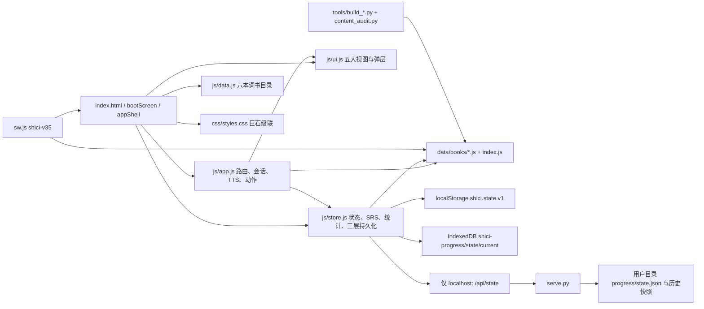
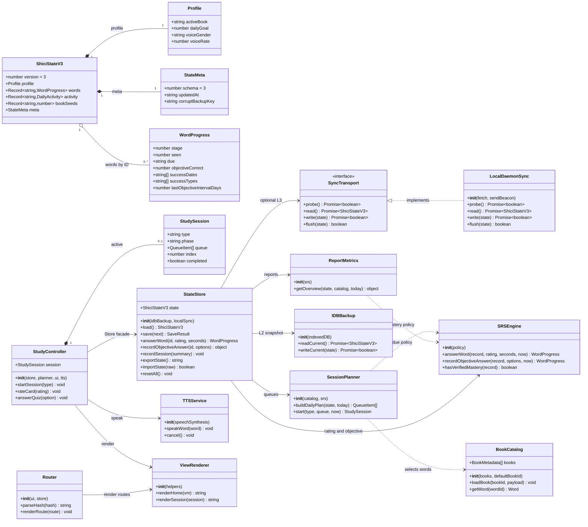
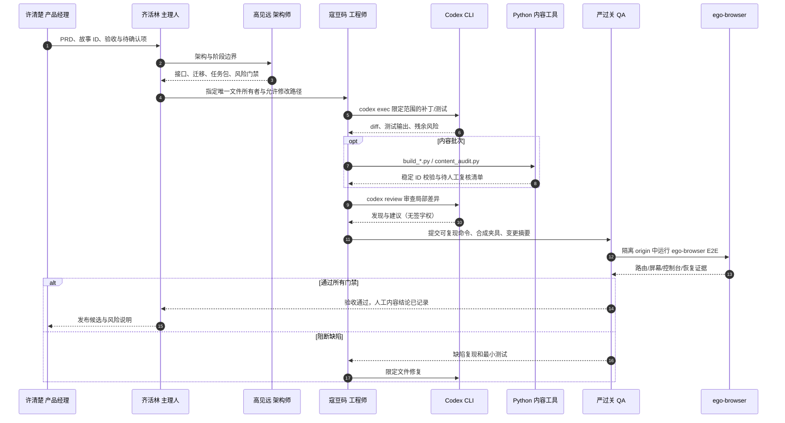
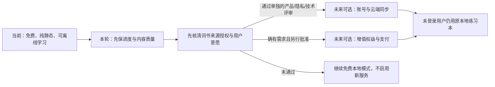
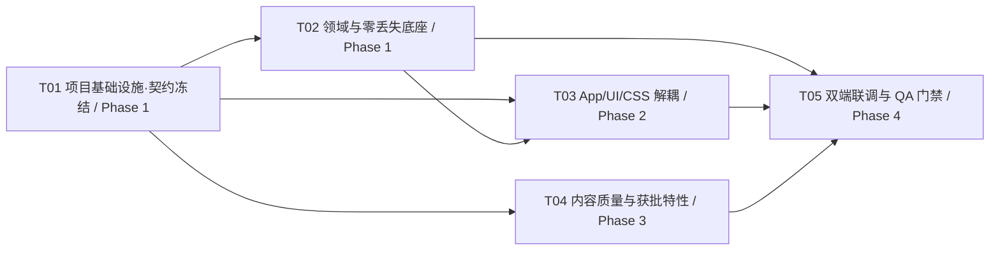

# 拾词（Shici）系统设计与 WorkBuddy × Codex 协同实施方案

> 版本：2026-11-22 架构基线。输入：`docs/01-shici-prd.md`、`docs/02-codex-architecture-audit.md` 与 `shici/docs/contracts/baseline.md`；设计以**当前源码与可执行基线**优先。文中“现有”和“目标”严格区分。本文件是设计与任务分解的唯一主文档；独立可渲染图见 `class-diagram.mermaid`、`sequence-diagram.mermaid`。应用文件路径以下均相对于 `shici/`，文档路径相对于本目录。

## Part A · 系统设计

### 1. 实施路径、挑战与选型

#### 1.1 现状架构全景



当前 `index.html` 以 **product-analytics → premium-config → state-schema → srs-engine → state-integrity → entitlements → data → store → ui → app** 的传统脚本顺序启动；`js/app.js` 先加载词书清单和首个约 180KB 分段，再在后台补齐剩余分段，而非阻塞等待完整词书。CSS 与应用资源 `?v=35`，词书分段 `?v=27`，SW 缓存键为 `shici-v35`。词书为 gaokao 3663、curated 120、wenyan 1200、ielts 3426、cet4 1162、cet6 1228，共 **10,799**；`curated` 的 120 个词条 ID 与 `wenyan` 核心 120 的 ID 和顺序一致，状态在 `state.words[id]` 上共享。

| 巨石/边界 | 实际耦合与证据 | 具体风险 | 首要解法 |
|---|---|---|---|
| `js/app.js` | 哈希路由、7 词会话状态机、客观题、TTS、快捷键、全局事件与 DOM 拼装同文件 | 评分后多处同步 UI、同一动作重复触发、会话中断难恢复 | 控制器/路由/TTS 逐个抽取，保留动作名与经典脚本入口 |
| `js/store.js` | `answerWord`/`recordObjectiveAnswer` 同时触碰算法、状态与 `save()`；`save()` 直接写 L1、异步 L2、远端去抖 | L1 失败仍发 saved 事件、异步备份未确认、远端竞态与旧快照回写 | 先锁兼容面，提纯 SRS/计划/指标，再收束写入协调 |
| `js/ui.js` | 5 视图+会话+抽屉模板共处，依赖 Store 与 escaping helpers | 某页面改变影响其他页面、数据和呈现混杂 | 页面/组件拆分；短期 facade 保持 `window.UI` |
| `css/styles.css` | 单一大样式表承载令牌、布局、页面、组件和响应式覆盖 | 级联顺序难审计、拆分会出现同名选择器漂移 | 先按原有顺序机械切分，再做视觉比较 |
| `js/data.js` / `data/books/` | 目录元数据与 JS 词书动态加载、书内 ID 顺序被学习记录引用 | 内容再生成可能改变 ID 或打断跨书共享 | 以 T01 基线逐项比较 ID、顺序、词数 |
| `sw.js` / `serve.py` | 离线缓存版本与 HTML 资源版本手工同步；本机 `/api/state` 返回/接收**原始状态 JSON** | 部分缓存失败可能新旧资源混用；接口协议被误改 | 更新前校验资源、保留上一代、/api 不缓存；API shape 不改 |
| `tools/test_learning_system.sh` | 当前脚本会调用 `Store.resetAll()` | 若在真实学习 origin 运行会擦除真实学习进度 | 必须隔离端口、profile、`SHICI_STATE_DIR`，QA 才执行 |

#### 1.2 零构建兼容的关键决策

1. **本轮不采用默认 Vite + React + MUI + Tailwind**。PRD 和委派要求 GitHub Pages 原样静态直出与 `file://` 本地打开；原生 ESM 从 `file://` 在主流浏览器受 CORS/opaque origin 制约，React/Vite 更要求构建。本轮沿用 **classic script + IIFE 命名空间 + facade**，纯函数文件也挂 `window.ShiciModules`；`index.html` 按依赖显式顺序引入，不动态 `import()`、不需 npm/构建。将来是否以 ESM 换取模块封装并牺牲部分 `file://` 兼容，是**用户确认后的产品决策与跨浏览器门禁**，不是已决定的迁移，也不是当前事实。
2. 架构形态是**小型分层 MVC**：`data/` 只读目录、`domain/` 纯计算、`storage/` 唯一写状态、`ui/` 字符串视图、`app/` 控制器。`js/store.js` 保留现有 `window.Store` 对外 API，`js/ui.js` 保留 `window.UI`，`js/app.js` 保留引导/委托入口。禁止领域层依赖 `window`、DOM、网络、时钟隐式读取；通过参数 `now` 与目录数据注入。
3. 不另造持久化 JSON 信封。**真实 V3** 已是 `{version:3, profile, words, activity, bookSeeds, meta:{schema:3,...}}`；`WordProgress` 直接是 `words[wordId]` 的扁平字段。若将来需要 `revision`、`writerId` 或 `mutationId`，先做附加可选字段与往返兼容试验，不能把现有数据改成 `{schemaVersion,data:{records}}`，也不能把这当“已实现”。
4. SRS 的现行自评值为 **`again | fuzzy | known`**，不是 SM-2 式 `hard/good/easy`。`hasVerifiedMastery` 要至少 3 个不同成功日期、2 种题型，且最近一次客观间隔 ≥7 天；`manualLongTerm` 不能冒充客观验证。到期 `due` 当前是本地日 `YYYY-MM-DD`，`updatedAt` 等是 UTC ISO 时间点，不能无迁移把 due 改为 `dueAt` UTC。
5. 三层防丢的边界：L1 `localStorage` 同步主状态、L2 IndexedDB `shici-progress`/`state`/`current` 完整快照、L3 仅本机守护进程 `/api/state` 原始 JSON 快照。`file://` 无 SW/本机 API；若浏览器不允许 file origin 的 IDB/localStorage，必须明确告警并保留内存/导出能力，**不能承诺双击模式所有浏览器自动持久**。GitHub Pages 无本机 API，不能把路径误发线上域名。
6. Python 后端只保留标准库 `serve.py` 本机环回服务；**不是云后端/账号体系**。内容 ETL 为 Python 标准库；Node 原生测试运行器可选作开发工具，不进入浏览器发布包。`ego-browser` 与 Codex 是本机外部执行器，不是应用依赖。

```mermaid
flowchart TD
    Book[data/books/*.js + index.js] --> Catalog[js/data.js BookCatalog]
    Catalog --> Domain[js/domain/ pure SRS / session / metrics]
    Domain --> Facade[js/store.js public Store facade]
    Facade --> Persist[js/storage/state-store.js]
    Persist --> LS[localStorage]
    Persist --> IDB[js/storage/idb-backup.js]
    Persist --> Sync[js/storage/local-daemon-sync.js]
    Sync --> Local[serve.py /api/state localhost only]
    Facade --> Ctrl[js/app/study-controller.js]
    Ctrl --> View[js/ui/views/*.js + components/*.js]
    View --> UI[js/ui.js public UI facade]
    Ctrl --> App[js/app.js bootstrap + action delegate]
    App --> Route[js/app/router.js]
    App --> TTS[js/app/tts-service.js]
    CSS[css/tokens.css + layout.css + components.css + views/*.css] --> View
    SW[sw.js only HTTP(S)] --> App
```

> 图中箭头表示**数据/调用路径**，不是许可逆向 import。真实依赖约束：`domain` 不依赖 UI/存储，`storage` 不依赖 UI/App，`ui` 消费只读 ViewModel，`app` 组合服务；Store facade 是唯一公共状态写入口。

### 2. 文件清单与所有权（相对于 `shici/`）

| 层 | 现有保留/目标新增文件 | 合同与注意事项 |
|---|---|---|
| 项目基础 | `index.html`、`serve.py`、`sw.js`、`manifest.webmanifest`、`tools/check_project.py`、`docs/contracts/baseline.md` | 零构建入口、现行 SW 与内容版号、静态契约；任何页面仍支持直接加载经典脚本 |
| 目录内容 | `js/data.js`、`data/books/index.js`、`data/books/index.json`、`data/books/gaokao.js`、`data/books/curated.js`、`data/books/wenyan.js`、`data/books/ielts.js`、`data/books/cet4.js`、`data/books/cet6.js` | 六本 10,799 条，稳定 ID/顺序；JSON 是校验清单，不强制 file 首屏 fetch |
| 领域（新增） | `js/domain/srs-engine.js`、`js/domain/session-planner.js`、`js/domain/report-metrics.js` | 纯函数 IIFE 导出 `ShiciModules.*`，参数显式传入状态、时间、目录 |
| 状态与持久化（新增） | `js/storage/state-store.js`、`js/storage/idb-backup.js`、`js/storage/local-daemon-sync.js` | 原形状、受保护导入/导出、origin 探测、保存失败状态；`js/store.js` 是现有公共门面 |
| 五页面（新增） | `js/ui/views/home.js`、`js/ui/views/study.js`、`js/ui/views/library.js`、`js/ui/views/books.js`、`js/ui/views/report.js` | `renderHome/renderStudyCenter/renderLibrary/renderBooks/renderReport` 与现有 DOM 结构适配 |
| 会话与共用组件（新增） | `js/ui/components/session.js`、`js/ui/components/drawers.js`、`js/ui/components/search.js`、`js/ui/components/helpers.js` | `renderSession/wordDrawer/settingsDrawer/modal/searchSuggestions` 由 `js/ui.js` 代理，沿用 `data-action` |
| 应用控制（新增） | `js/app/router.js`、`js/app/tts-service.js`、`js/app/study-controller.js` | `js/app.js` 现有入口只委托；路由保留 `#home/#study/#library/#books/#report` |
| 样式（新增） | `css/tokens.css`、`css/layout.css`、`css/components.css`、`css/views/home.css`、`css/views/study.css`、`css/views/library.css`、`css/views/books.css`、`css/views/report.css` | `css/styles.css` 是现有唯一入口，以按顺序 `@import` 聚合；`css/info-pages.css` 保留独立 |
| 其他现有脚本 | `js/product-analytics.js`、`js/feedback.js`、`js/store.js`、`js/ui.js`、`js/app.js` | 保留产品统计、反馈与所有外部可见接口，非重构对象不得被误删 |
| 内容工具与验收 | `tools/build_books.py`、`tools/build_wenyan.py`、`tools/build_wenyan_catalog.py`、`tools/content_audit.py`、`tools/export_content_review.py`、`tools/test_learning_system.sh`、`tools/deploy_local.sh`、`tools/install_local.sh`；新增 `tools/tests/domain.test.cjs`、`tools/tests/storage.test.cjs`、`tools/tests/compat.test.cjs` | 测试 fixtures 仅合成状态；绝不提交真实 `progress/`、备份或学习事件 |

**经典脚本加载约定**：保持 `product-analytics.js`、`data.js` 在前；再依序加载领域、storage、视图/组件、app 子模块；最后依序执行 `store.js`、`ui.js`、`app.js`，不得由一个文件提前引用尚未定义的全局值。短期采取 strangler 方式每抽一个职责即运行行为回归；先保留原入口，再删掉对应旧实现，避免双重事件注册。`sw.js` 的 APP_SHELL 与 `index.html` 新增 `<script>/<link>` 必须同提交同步。

### 3. 数据结构与核心接口

以下是**JavaScript JSDoc 的目标接口**，不是要在现有状态上强造类实例。序列化仍是 plain object；类图服务类表示可独立测试的封装，允许实现成闭包/函数对象。

```js
/** @typedef {{
 * version: 3,
 * profile: {name:string,dailyGoal:number,voiceGender:'male'|'female',
 *   voiceRate:number,targetRetention:number,createdAt:string,activeBook:string},
 * words: Record<string,WordProgress>, activity: Record<string,DailyActivity>,
 * bookSeeds: Record<string,number>,
 * meta: {schema:3,sessions:number,quizSessions:number,updatedAt:string|null,
 *   lastServerSavedAt:string|null,lastBackupAt:string|null,
 *   corruptBackupKey:string|null,[extra:string]:unknown}
 * }} ShiciStateV3 */
/** @typedef {{stage:number,seen:number,due:string|null,firstSeen:string|null,
 * lastReviewed:string|null,lastRating:'again'|'fuzzy'|'known'|null,
 * favorite:boolean,weak:boolean,books:string[],selfRatings:{again:number,fuzzy:number,known:number},
 * objectiveSeen:number,objectiveCorrect:number,objectiveWrong:number,
 * spellingSeen:number,spellingCorrect:number,spellingWrong:number,
 * successDates:string[],successTypes:string[],lastObjectiveIntervalDays:number,
 * manualLongTerm:boolean,[extra:string]:unknown}} WordProgress */
/** @typedef {{type:string,phase:'cards'|'quiz'|'spelling'|'summary',
 * queue:Array<{id:string,kind:string,requeue?:boolean}>,index:number,
 * revealed:boolean,outcomes:Record<string,object>,repeatMap:Record<string,number>,
 * startedAt:number,completed:boolean,quiz?:object,summary?:object}} StudySession */
/** @typedef {{books:BookMetadata[],activeBookId:string,
 * loadBook:(bookId:string,payload:object)=>void,getBook:(id:string)=>BookMetadata|null,
 * getWord:(id:string)=>Word|null}} BookCatalog */
/** @typedef {{probe:()=>Promise<boolean>,read:()=>Promise<ShiciStateV3|null>,
 * write:(state:ShiciStateV3)=>Promise<boolean>,flush:(state:ShiciStateV3)=>boolean}} SyncTransport */
```

`WordProgress` 上还有原代码的其他字段（如 `quizSeen`、`difficulty`、`retention24/7`、`hintsUsed`、`confusions`），上述列表为**必需设计子集，不是序列化白名单**；迁移时保留所有现有及未知字段。`StudySession` 目前只驻留在 `app.session` 内存中，中断恢复属于 PRD P0 **待实现**；欲持久化，先新增与旧导出兼容的可选快照字段并证明不会重复计数。

| 服务/公共契约 | 目标方法（参数 → 返回） | 约束与兼容说明 |
|---|---|---|
| `BookCatalog` / `js/data.js` | `loadBook(bookId,payload) → void`、`getBook(id) → metadata|null`、`getWord(id) → Word|null` | 同 ID 跨书共享进度，不用数组序号作键 |
| `SRSEngine` | `answerWord(record,rating,seconds,now) → WordProgress`、`recordObjectiveAnswer(record,options,now) → WordProgress`、`hasVerifiedMastery(record) → boolean` | 不读系统时钟/全局状态；自评与客观证据不得合并计数 |
| `SessionPlanner` | `buildDailyPlan(state,today) → QueueItem[]`、`start(type,queue,now) → StudySession` | daily 一轮最多 7 个初始词；`again` 重入可使实际队列更长，保持现有规则 |
| `ReportMetrics` | `getOverview(state,catalog,today) → object`、`getRetention(state,days) → object`、`getHeatmap(state,today) → object` | 本地自然日聚合，时间点 ISO；指标从记录推导 |
| `StateStore` | `load() → ShiciStateV3`、`save(next) → SaveResult`、`answerWord(id,rating,seconds) → WordProgress`、`recordObjectiveAnswer(id,options) → object`、`recordSession(summary) → void`、`exportState() → string`、`importState(raw) → boolean`、`resetAll() → void` | facade 保留 **65 方法 + 2 getter + 6 常量** 的精确名称、参数、返回语义；上列仅分层关键项，完整清单以 `tools/check_project.py` 为准 |
| `IDBBackup` | `readCurrent() → Promise<State|null>`、`writeCurrent(state) → Promise<boolean>`、`hydrate(local) → Promise<RestoreResult>` | 数据库名 `shici-progress`，object store `state`，键 `current` |
| `LocalDaemonSync implements SyncTransport` | `probe/read/write/flush`，内部 `/api/state` | 仅可信 localhost 本机服务；GET 原始状态、404 空、POST 原始状态、200 `{ok,savedAt,...}`，**无现成 409/CAS 协议** |
| `StudyController` | `startSession(type)`、`revealCard()`、`rateCard(rating)`、`answerQuiz(option)`、`finishSession()` | 依赖 Store facade，不直接碰 localStorage；TTS 失败不阻塞 |
| `Router`、`ViewRenderer`、`TTSService` | `parseHash/navigate/renderRoute`、五视图及组件 `render*`、`preferredUsVoice/speakWord/cancel` | `data-action` 与 `window.UI` 十关键入口不变 |

**读/写/删与初始化边界**：书籍内容只读；学习记录通过 facade 增量更新整份状态并写 L1/L2，查询透过 facade；`resetAll` 是已有的破坏性清空入口，只允许设置界面明确确认、预先导出/快照且永不由 QA 对真实 origin 调用。迁移/导入必须 parse→validate→备份→原子替换→恢复验证，损坏原文继续使用 `shici.state.v1.corrupt.*` 隔离键。跨标签冲突和写入幂等为目标增强，不可误称当前已经具备。

#### 3.1 Mermaid 类图（完整图单独存为 `class-diagram.mermaid`）



### 4. 程序调用与关键流程

#### 4.1 初始化、七词微循环、CRUD 与三层保存（独立图：`sequence-diagram.mermaid`）

```mermaid
sequenceDiagram
    autonumber
    actor U as 学习者
    participant E as index.html / app.js
    participant C as BookCatalog
    participant P as SessionPlanner
    participant A as StudyController
    participant S as StateStore
    participant D as SRSEngine
    participant L as localStorage
    participant I as IDBBackup
    participant R as LocalDaemonSync
    participant PY as serve.py /api/state
    participant V as ViewRenderer
    E->>C: __init__(BOOKS, DEFAULT_BOOK)
    E->>S: __init__(IDBBackup, LocalDaemonSync); load()
    S->>L: getItem(shici.state.v1)
    L-->>S: raw V3 state / empty / corrupt
    opt 状态损坏
        S->>L: setItem(shici.state.v1.corrupt.timestamp, raw)
        Note over S,L: 禁止静默覆盖原文
    end
    S->>I: hydrate(state)
    opt localhost 可用
        S->>R: probe() / read()
        R->>PY: GET /api/state
        PY-->>R: 原始 JSON 或 404
        R-->>S: 可比较的远端快照
    end
    E->>C: loadBook(activeBookId, scriptPayload)
    E->>V: renderHome(S.getOverview())
    V-->>U: #home
    U->>A: startSession(daily)
    A->>P: buildDailyPlan(state,today) / start(daily,queue,now)
    P-->>A: StudySession(最多 7 初始词)
    loop 每张卡；again 可队尾重现
        A->>V: renderSession(session)
        V-->>U: 揭示与自评
        U->>A: rateCard(again|fuzzy|known)
        A->>S: answerWord(id,rating,seconds)
        S->>D: answerWord(record,rating,seconds,now)
        D-->>S: 更新 due 和自评证据
        S->>L: setItem(shici.state.v1, full state)
        alt L1 成功
            S->>I: writeCurrent(state) 异步备份
        else L1 失败
            S->>I: writeCurrent(state) 并等待结果
            Note over A,I: 双层失败不得确认已保存
        end
        opt 本机守护进程可用
            S->>R: write(state) 去抖 / 失败重试
            R->>PY: POST /api/state 原始 JSON
            PY-->>R: ok/savedAt
        end
    end
    U->>A: answerQuiz(option)
    A->>S: recordObjectiveAnswer(id,options)
    S->>D: recordObjectiveAnswer(record,options,now)
    S->>L: setItem(shici.state.v1, full state)
    A->>S: recordSession(summary)
    A->>V: renderSession(summary)
    U->>S: exportState() / importState(raw)
    Note over U,S: resetAll() 仅明确确认和备份后可执行
    opt pagehide
        S->>R: flush(state)
        R->>PY: sendBeacon best-effort
    end
```

**现状与目标差距**：T02 已实现 L1 成功即确认、L1 失败时等待 L2 事务成功再确认，以及 checksum 不一致时隔离原文并优先恢复有效 IDB 快照。仍未实现远端 409 冲突检测和多标签页完整 revision 分叉；须在不改动原始 `/api/state` 协议下继续设计冲突保留，再评估服务端 CAS 升级。**绝不**默认假设 `GET /api/state` 返回 `{code,data,message}`。

#### 4.2 WorkBuddy × Codex 研发闭环



### 5. 未澄清事项与设计假设

- PRD 写“会话中断后准确恢复”，当前 `app.session` 仅内存；需要产品确认是否**恢复未答卡片位置**、是否显示已答客观题反馈、跨书切换时是否放弃未完成会话。第一阶段只保证已提交学习事件不丢，完整会话恢复需合成 fixture 与第二阶段决策。
- 跨设备合并、账号/云端同步属于 P2 探索，当前没有账户、事件日志或 CAS；不得通过比较 `meta.updatedAt` 或求和现有 counters 伪实现无损合并。
- `file://` 真实持久化受浏览器实现、隐私设置影响；保留直接打开 UI/学习能力，但在 storage 不可用时显示无法保证进度的明确警告。
- 文言多义辨析和 fallback 例句人工复核需产品与内容责任人决定数据字段/审定名单；当前 `export_content_review.py --check` 仅表一致性，仍有 508 条待复核，不等于已审完。
- 商业化前必须核实词典等上游材料的授权链：已知 `KyleBing/dict` 是 `kajweb/dict` fork，上游 README 标注爬取应用数据，页面未见明确商业再分发授权；这**不是**授权已被允许的证据，需逐源确认数据权利或替换为可授权内容，并保留来源/许可证台账。
- `serve.py` 当前可通过 `SHICI_PORT`/`SHICI_STATE_DIR` 隔离测试目录，`/api/state` 无鉴权，仅监听 `127.0.0.1`；不能把这个接口当线上云同步。

### 5.1 给不懂代码的使用者：先把学习站守稳，再验证可选收费

把当前拾词想成一本**装在浏览器里的练习本**：词书和页面是可下载的印刷内容；`shici.state.v1` 是个人在这本练习本上的笔记。本机 4173 服务像家里的备份抽屉，GitHub Pages 和直接双击文件则不自动拥有这只抽屉。本轮要做的是把练习本的页码、笔记、备份和错题规则整理清楚；不是立即开账号、收钱或上传你的学习记录。



| 面向用户的问题 | 本轮能承诺什么 | 未来若要上线商业功能，必须先做什么 |
|---|---|---|
| “不注册还能学吗？” | **能**。五页面、学习、自评、客观题、离线/本地导出沿用现有链路，不设付费墙。 | 云同步必须可选；未登录继续本地写入，手动备份/导入可用，注销账户不能清掉本地进度。 |
| “我会不会一付费就把词丢了？” | 本轮不做收费或云合并，只做好原有三层备份安全与合成数据恢复。 | 先设计明确的用户同意、上传预览、备份与回退、冲突处理/幂等规则；未经同意不把既有笔记自动上传。 |
| “为什么不能马上卖词书？” | 有内容来源授权疑点，先不声称这些词书可商用。 | 逐份核对上游来源、许可、商业再分发权与需替换的内容；人工/法律审核通过之前不售卖相关内容。 |
| “付费买什么才合理？” | 免费核心学习、复习、词书浏览不减配。 | 先访谈和小范围验证真实需求，再考虑可选便利服务（例如跨端备份或自愿购买的增值讲解）；权利、隐私、退款和支付合规另行评审，不在本轮编码。 |

未来若获批，引入账号/云同步应是**可关闭的独立适配器**，而不是把云端变成离线学习的启动依赖：启动先读本地；用户明确登录和授权后才触发上传；断网仍完成学习并安全排队；退出账号或服务停用不应锁住本地学习和 JSON 导出。需要最小权限、明确数据用途/保留时长、删除/撤回流程、跨设备冲突预览；支付系统和权益服务应与学习状态隔离，服务故障不能使卡片学习不可用。若要第三方登录、支付或云数据库，届时另行选型、预算与隐私评审，**当前没有这些后端、也没有已开通的支付能力**。用户确认目标后再扩充下一轮任务，不把它偷偷塞进 T01–T05。

## Part B · 实施任务分解

### 6. 必需软件包与工具

- **浏览器运行时第三方包：无。** 使用 Web 标准 DOM、Web Speech API、IndexedDB、Service Worker、classic script/IIFE；不引入 `react`、`@mui/material`、`tailwindcss` 或 `vite`，因为其构建/模块路径与本项目 `file://` 约束冲突。
- **Python 第三方包：无。** `serve.py`、`tools/build_*.py`、`content_audit.py` 用 Python 3 标准库；是否需要新增库须另提 ADR。
- **开发环境工具（非发布依赖）**：Node.js（`node --check`、`node --test`），本机 Codex CLI v0.171.0-alpha.13（确认实际 `codex --help` 后执行）、`ego-browser`（先读取其 skill 帮助/运行文档）、Git/Python 3。不要凭计划稿假定 `--strict`、`--output`、`--check` 等未实现开关已可用。

### 7. 有序任务清单（**5 个功能任务包，含 12 个验收子步骤，不增加独立任务数**）

每包至少覆盖 3 个相关文件；同包内各含若干检查点，**共 12 个，对应既存 Codex 草案的 T01–T12 检查点**；它们只是检查点映射，不是另建工程任务或给其另起 T06–T12 编号。映射为：本 T01 承接草案检查点 T01–T03，本 T02 承接 T04–T06，本 T03 承接 T07–T09，本 T04 承接 T10–T11，本 T05 承接 T12；若草案具体检查点含义不同，应在合稿时逐项核对、不要把此分配冒充原稿编号/原文的完全对应。**T01 必须是“项目基础设施”**，涵盖配置/入口/依赖声明；“依赖声明”在这里是**零运行时包**的清单，而非强加 `package.json` 构建工具。每个包由 WorkBuddy 成员承担决策/评审，Codex 只能做约束内执行。

| 任务 ID / 阶段 | 名称、执行方与子步骤 | 输入 → 输出文件（相对于 `shici/`） | 依赖 / 优先级 | 验收标准 |
|---|---|---|---|---|
| **T01 / Phase 1** | **项目基础设施与冻结契约**。齐活林定边界，寇豆码执行，Codex 限定扫描，严过关独立核验。子步骤 ① 现有脚本与 `file://`/HTTP/SW 三模式入口基线；② Store/UI/route/action 契约；③ 词书 ID/顺序/数量基线。**仅部分实现**：`shici/docs/contracts/baseline.md` + `tools/check_project.py` 已冻结静态 API 成员名/类别与六书数据；尚未冻结 Store 参数/返回语义、路由/动作行为金样本，QA 又发现静态检查的词法绕过并正在修。故 T01 **不能标为整包验收完成**。 | 输入 `index.html`,`manifest.webmanifest`,`js/data.js`,`js/store.js`,`js/ui.js`,`js/app.js`,`sw.js`,`data/books/index.json` → 输出/修改 `docs/contracts/baseline.md`（零第三方依赖声明）,`tools/check_project.py`,`index.html`（入口）,`manifest.webmanifest`（配置）,`sw.js`,`serve.py`；配置、入口、依赖声明同属本任务。 | 无 / **P0** | `python3 tools/check_project.py`；`python3 tools/export_content_review.py --check`；`for file in js/*.js sw.js; do node --check "$file" || exit 1; done`；直接打开与本机服务均启动；73 Store 成员、十 UI 入口、六书全序固定；进一步用合成数据冻结公开参数/返回、五 hash 路由、关键 `data-action` 行为金样本；QA 词法绕过修复经独立复核。静态通过不代表浏览器通过。 |
| **T02 / Phase 1** | **领域算法与零丢失底座**。高见远负责契约/评审，寇豆码+Codex 实现，严过关验证。子步骤 ④ 提纯 SRS/计划/报告；⑤ L1/L2 故障安全与损坏保留；⑥ L3 守护进程同步/导入导出、跨标签风险。 | 输入 `js/store.js`,`serve.py`,`docs/contracts/baseline.md` → 输出 `js/domain/srs-engine.js`,`js/domain/session-planner.js`,`js/domain/report-metrics.js`,`js/storage/state-store.js`,`js/storage/idb-backup.js`,`js/storage/local-daemon-sync.js`,`js/store.js`,`tools/tests/domain.test.cjs`,`tools/tests/storage.test.cjs`。 | T01 / **P0** | 合成 V3/旧字段往返不丢记录，3 日/2 类/7 天掌握条件，`again/fuzzy/known` 与客观计分分离；L1 配额失败→L2 确认，双失效不得假报 saved；GET/POST 保持原始 JSON，断网继续本地；运行 `node --test tools/tests/domain.test.cjs tools/tests/storage.test.cjs`（文件实现后）。 |
| **T03 / Phase 2** | **App/UI/CSS 模块化**。寇豆码+Codex 实施，许清楚校文案，高见远评边界，严过关抽验。子步骤 ⑦ 五视图及组件；⑧ 路由/会话/TTS 解耦；⑨ 样式机械拆分与移动端核对。 | 输入 `js/app.js`,`js/ui.js`,`css/styles.css`,`index.html` → 输出 `js/app/router.js`,`js/app/study-controller.js`,`js/app/tts-service.js`,`js/ui/views/{home,study,library,books,report}.js`,`js/ui/components/{session,drawers,search,helpers}.js`,`js/app.js`,`js/ui.js`,`css/{tokens,layout,components}.css`,`css/views/{home,study,library,books,report}.css`,`css/styles.css`,`index.html`,`sw.js`,`tools/tests/compat.test.cjs`。 | T01、T02 / **P1** | Store 73 成员+UI 十入口未改变，历史 hash/data-action/焦点/TTS 行为保持；classic script 顺序、file 浏览器直开；`node --test tools/tests/compat.test.cjs`；390px/桌面五视图截图差异经 QA 人工确认。 |
| **T04 / Phase 3** | **内容质量闭环与获批新特性**。许清楚决定内容优先级，寇豆码+Codex 执行 Python ETL，严过关审计。子步骤 ⑩ fallback 全量审阅与稳定 ID 门禁；⑪ 文言多义/报告可行动性可选新增特性（以 PRD 批准为前提）。 | 输入 `data/books/*.js`,`data/books/index.json`,`tools/build_books.py`,`tools/build_wenyan.py` → 输出/修改 `tools/content_audit.py`,`tools/export_content_review.py`,`tools/build_wenyan_catalog.py`,`data/books/index.json`,`data/books/{curated,wenyan}.js`,`js/ui/views/{study,report}.js`（仅批准后）。 | T01 / **P1**（P0 内容审计门禁） | 六书 10,799、curated/wenyan 共享 ID 不漂移；`python3 tools/content_audit.py` 与 `python3 tools/export_content_review.py --check`；508 待复核逐条人工结论，不以工具通过声称内容已审；不运行会直接重写词书的构建脚本于未隔离工作树。 |
| **T05 / Phase 4** | **双端联调、ego-browser 验收与发布门禁**。严过关负责，齐活林签字，寇豆码修复，Codex review 仅辅助。子步骤 ⑫ GitHub Pages/本机/隔离 file、离线升级、状态恢复、回滚演练。 | 输入 T01–T04 全部源码与合成夹具 → 输出/修改 `tools/test_learning_system.sh`,`tools/check_project.py`,`sw.js`,`index.html`,`serve.py`,`tools/tests/compat.test.cjs`；验收证据记录在已有 `docs/contracts/baseline.md` 或团队统一验收记录（不提交用户快照）。 | T02、T03、T04 / **P0 发布门禁** | 所有静态/Node 测试，`codex review` 发现有处置；`ego-browser` 隔离端口+临时 `SHICI_STATE_DIR` 验证五路由、7 词循环、两类评分、TTS 降级、断网/刷新/退出/导入导出、SW 从旧版升新版；绝不对真实 `127.0.0.1:4173`/线上 origin 调用 `resetAll()`；QA 与主理人双签。 |

**可执行命令规范**（在仓库根目录运行，路径带空格应以 shell 工作目录或引号处理）：

```sh
python3 tools/check_project.py
python3 tools/export_content_review.py --check
for file in js/*.js sw.js; do node --check "$file" || exit 1; done
# 下两项仅在 T02/T03 新测试文件落地后运行：
node --test tools/tests/domain.test.cjs tools/tests/storage.test.cjs tools/tests/compat.test.cjs
```

Codex CLI 用绝对路径定位；`codex exec` 要求非交互、提示词限定允许文件与验收，命令参数以本机 `--help` 实测，不把草稿里的 `codex review --base main` 视为已验证参数。典型交接包：任务 ID/PRD 故事→文件白名单→不能变的 Store/UI/state 兼容面→合成数据测试→退出码与 diff→未解决风险。`codex review` 单独审本轮 diff，工程师复核建议，Codex 无发布签字权。Python 内容工具只处理只读/生成词书，不写用户进度。`ego-browser` 一定先按本机技能说明加载，再在隔离浏览器 origin 使用。

#### WorkBuddy × Codex 分工矩阵

| 工作域 | 决策与负责 A | 执行 R | 审查/交接合同 |
|---|---|---|---|
| PRD、范围、内容严重度 | 许清楚；整体排期齐活林 | 许清楚 | 故事 ID、可测 Given/When/Then、人工复核清单交高见远/严过关 |
| 分层、状态契约、SRS 不变量 | 高见远 | 高见远/寇豆码；Codex 受控补丁 | 以 T01 冻结契约+合成夹具为准；架构变更先评审后写代码 |
| 实现与集成 | 寇豆码 | 寇豆码、`codex exec` | 允许文件列表、diff、测试输出，不能擅改 73 Store 成员或内容 ID |
| 代码审查 | 寇豆码处理；高见远审关键接口 | `codex review` 提供独立发现 | 原因/影响/复现/修复记录；Codex 无决定权 |
| 内容 ETL 与审阅 | 许清楚决定结论 | 寇豆码、Python `tools/build_*.py`/`content_audit.py` | 稳定 ID/数量报告，人审 508 项后才可关闭内容门禁 |
| 浏览器 QA 与发布安全 | 严过关拥有质量否决；齐活林发布签字 | 严过关、`ego-browser` | 隔离 origin、截图、控制台、迁移与恢复证据；真实 `progress/` 零访问 |

### 8. 跨文件共享知识与风险防控

1. **状态键不可迁**：`shici.state.v1`，内部 `version = meta.schema = 3`；导出/导入是原形状。Store 顶层**65 个方法、2 getter（`words`,`units`）、6 常量**，UI 十入口以基线检查器为准。将字段改为 `data.records` 会破坏当前用户快照和 `serve.py` 的 `words` 结构校验。
2. **同步有条件**：本机 `serve.py` `127.0.0.1:4173`（测试可用 `SHICI_PORT` 改端口），`GET /api/state` 返回原始状态/404，`POST` 收原始 JSON、响应 `{ok,bytes,savedAt,...}`。当前 450ms 去抖、8s 重试、30s 补偿与 `sendBeacon` 只是 best effort；不能凭其成功与否删除本地记录。GitHub Pages/file 不可触发该接口；不要引入 JWT 或假设 `{code,data,message}`。
3. **本机进度隔离**：默认 `~/Library/Application Support/Shici/progress/`，含 `state.json`、`state.prev.json`、`history/daily`、`history/checkpoints`，**不在仓库**。部署 `tools/deploy_local.sh` 的 `--exclude 'progress/'` 绝不删除/覆盖；在任何 ETL、测试、Codex 脚本中不得复制真实数据进 fixtures、日志、提交或上传。破坏性用例临时目录 `SHICI_STATE_DIR` + 独立端口/profile。
4. **持久化升级顺序**：归一化旧字段而非重新命名；先备份可恢复原始字节，写入后验证；只有 L1 或 L2 一层确实成功才能显示“已保存”。损坏原文隔离 `shici.state.v1.corrupt.*`；双方分叉时禁止只看“时间更新”直接覆盖。无日志无法安全做跨设备计数相加，P2 另做事件身份设计。
5. **词条身份与时间**：进度按词条 ID 而非书名/位置；curated 120 同 wenyan 核心 120 共享。`due`/`activity` key 是本地 `YYYY-MM-DD`；`createdAt/updatedAt/lastReviewed` 为时间点（已有字段可能历史格式不一，迁移前从 fixture核验）。不要统一替换成 UTC 日期而改变复习跨天语义。
6. **Service Worker 版本**：当前 `shici-v35` 保留前一代，资产 `?v=35`，词书分段 `?v=27`；拆分脚本/CSS 同时更新预缓存清单和应用版本，词书内容未变不得无故 bump 内容版本。当前安装 `cache.add` 逐项吞错，目标需核心资源成功才激活新版本；已验证线上 `v27 → v28` 词书复用升级，并继续验证每次新版本首访在线→离线、旧标签运行→新版本激活、旧缓存保留与下一次刷新，任何缓存逻辑**不得**拦截 `/api/` 或清浏览器存储。
7. **内容工具现状**：`check_project.py` 已经精确锁 API 与词书顺序；`export_content_review.py --check` 校验审阅表一致性，当前 508 待复核；计划中的 `--strict`、`--output`、构建工具 `--check` 和 `tools/check_static.mjs` 不在现有基线中，不能直接当验收命令。
8. **可访问与信任体验**：UI 动态内容必须 HTML 转义；键盘焦点、`aria-live`、抽屉恢复、390px 触控；朗读选择 `en-US` 男女声与语速，TTS 无声/权限失败不能阻塞答题。自评与客观提取在统计与文案中分开呈现。

### 9. 任务依赖图



**发布定义**：T01–T05 验收并非只看代码能运行；必须有不触碰真实数据的独立 QA 证据、人工内容结论、file/HTTP/离线兼容与回滚演练。`file://` 环境的浏览器存储限制与设备存储全部失效属于无法无条件保证的物理边界，产品应提示备份而不是承诺绝对零丢失。
